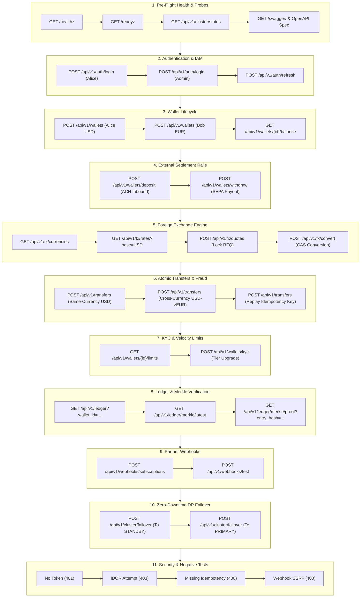

# End-to-End API Testing & Verification Guide with Bruno

**Project**: Global Multi-Currency Digital Wallet & Ledger Service  
**Target Environments**: 
- **Docker Compose**: `http://localhost:8080` (API Gateway)
- **Kubernetes (k8s)**: `http://localhost:30080` (NodePort)
**Recommended Tool**: [Bruno](https://www.usebruno.com) (Fast, Git-Friendly Open-Source API Client)  
**Collection Directory**: [`bruno/`](../bruno/)

---

## 1. Executive Summary & Why Bruno?

This document provides a comprehensive, sequential, end-to-end testing guide for the entire **Global Multi-Currency Digital Wallet & Ledger Microservices Platform** using **Bruno**.

### Why Bruno instead of Legacy API Clients?
1. **Local & Git-Native**: Bruno stores collections as plain text `.bru` and JSON files inside the repository (`bruno/`), meaning tests evolve in lockstep with the microservice source code.
2. **Zero Cloud Dependency & Zero Telemetry**: Operates 100% offline; credentials, JWT secrets, and tokens never leak to external cloud servers.
3. **Automated Variable Chaining**: Automatically extracts authentication tokens, wallet IDs, and fixed-rate FX quote IDs via `script:post-response` to drive sequential multi-stage financial workflows without manual copy-pasting.
4. **Built-in Assertions & Scripting**: Native assertions (`assert { res.status: eq 200 }`) validate compliance, idempotency deduplication, and HTTP status codes automatically.
5. **CLI Test Runner (`@usebruno/cli`)**: Run the complete 12-suite end-to-end regression suite directly from the command line or CI/CD pipelines via `bru run`.

---

## 2. Quickstart: Setting Up Bruno

### 2.1. Install Bruno
- **Windows**: `winget install Bruno.Bruno` or download installer from [usebruno.com/downloads](https://www.usebruno.com/downloads).
- **macOS**: `brew install bruno`
- **Linux**: `snap install bruno` or `.deb` / `.rpm` package.
- **Bruno CLI** (for automated terminal execution):
  ```bash
  npm install -g @usebruno/cli
  ```

### 2.2. Open the Collection in Bruno
1. Launch **Bruno**.
2. Click **Open Collection** on the home screen.
3. Browse to this repository and select the [`bruno/`](../bruno/) folder.
4. In the top-right environment selector dropdown, select **`Local-Docker`** (for port `:8080`) or **`Local-Kubernetes`** (for NodePort `:30080`).

---

## 3. Environment Variables & Runtime Tokens

The collection includes preconfigured environments in [`bruno/environments/`](../bruno/environments/):

| Variable Name | Default Value (Docker) | Default Value (K8s) | Description |
|---|---|---|---|
| `baseUrl` | `http://localhost:8080` | `http://localhost:30080` | Edge Ingress API Gateway URL |
| `adminUsername` | `admin` | `admin` | Default administrative user identity |
| `adminPassword` | `admin123` | `admin123` | Master auth-service administrative password |
| `jwtSecret` | `global-wallet-super-secret-jwt-key-2026` | `global-wallet-super-secret-jwt-key-2026` | HMAC-SHA256 signature secret for mock tokens |
| `authToken` | *(Dynamic)* | *(Dynamic)* | Runtime Bearer token extracted from `/api/v1/auth/login` |
| `adminToken` | *(Dynamic)* | *(Dynamic)* | Administrator token with `ADMIN` role and `cluster:admin` scope |
| `aliceWallet` | `alice_usd` | `alice_usd` | Primary customer wallet ID |
| `bobWallet` | `bob_eur` | `bob_eur` | Counterparty recipient wallet ID |
| `quoteId` | *(Dynamic)* | *(Dynamic)* | Guaranteed 60-second fixed FX quote ID (`fxq_...`) |
| `lastTxnId` | *(Dynamic)* | *(Dynamic)* | Transaction reference returned from transfers |

---

## 4. End-to-End Testing Workflow Architecture

The sequential testing plan executes across **11 cohesive stages**:



---

## 5. Detailed Step-by-Step API Testing Guide

---

### STAGE 1: Pre-Flight Health, Cluster Discovery & Documentation

#### 1.1. Gateway Liveness Probe
- **Method & Path**: `GET {{baseUrl}}/healthz`
- **Auth**: None (Public)
- **Expected Response**: `200 OK`
  ```json
  {
    "status": "UP"
  }
  ```
- **Bruno Assertion**:
  ```bru
  assert {
    res.status: eq 200
    res.body.status: eq UP
  }
  ```

#### 1.2. Cluster Readiness Probe (Backend Dependencies)
- **Method & Path**: `GET {{baseUrl}}/readyz`
- **Auth**: None (Public)
- **Expected Response**: `200 OK`
  ```json
  {
    "status": "READY",
    "wallet_primary": "SERVING",
    "ledger_service": "SERVING",
    "auth_service": "SERVING",
    "fx_service": "SERVING"
  }
  ```
- **Bruno Assertion**:
  ```bru
  assert {
    res.status: eq 200
    res.body.status: eq READY
  }
  ```

#### 1.3. Active Cluster Routing Status
- **Method & Path**: `GET {{baseUrl}}/api/v1/cluster/status`
- **Auth**: None (Public)
- **Expected Response**: `200 OK`
  ```json
  {
    "active_target": "PRIMARY",
    "region": "us-east-1",
    "primary_target": "PRIMARY",
    "standby_target": "STANDBY",
    "timestamp": 1729760000
  }
  ```
- **Bruno Assertion**:
  ```bru
  assert {
    res.status: eq 200
    res.body.active_target: eq PRIMARY
  }
  ```

#### 1.4. OpenAPI 3.0 Contract Specification
- **Method & Path**: `GET {{baseUrl}}/api-docs/openapi.json`
- **Auth**: None (Public)
- **Expected Response**: `200 OK` (Valid OpenAPI JSON with `openapi: "3.0.3"`)
- **Interactive UI**: Open `http://localhost:8080/swagger/` in any web browser to view the embedded Swagger UI documentation.

---

### STAGE 2: Authentication, Token Minting & Session Management

#### 2.1. Customer Login (Alice)
- **Method & Path**: `POST {{baseUrl}}/api/v1/auth/login`
- **Headers**: `Content-Type: application/json`
- **Request Body**:
  ```json
  {
    "username": "alice",
    "password": "password123"
  }
  ```
- **Expected Response**: `200 OK`
  ```json
  {
    "access_token": "eyJhbGciOi...",
    "refresh_token": "eyJhbGciOi...",
    "token_type": "Bearer",
    "expires_in": 3600,
    "user_id": "alice",
    "roles": ["USER"],
    "scopes": ["wallet:read", "wallet:write", "wallet:transfer"]
  }
  ```
- **Bruno Post-Response Script**:
  ```bru
  script:post-response {
    if (res.getStatus() === 200) {
      bru.setEnvVar("authToken", res.getBody().access_token);
      bru.setEnvVar("refreshToken", res.getBody().refresh_token);
    }
  }
  ```

#### 2.2. Administrator Login (Admin)
- **Method & Path**: `POST {{baseUrl}}/api/v1/auth/login`
- **Headers**: `Content-Type: application/json`
- **Request Body**:
  ```json
  {
    "username": "admin",
    "password": "admin123"
  }
  ```
- **Expected Response**: `200 OK` (with `roles: ["ADMIN"]` and scopes including `cluster:admin`, `wallet:kyc:admin`).
- **Bruno Post-Response Script**:
  ```bru
  script:post-response {
    if (res.getStatus() === 200) {
      bru.setEnvVar("adminToken", res.getBody().access_token);
    }
  }
  ```

#### 2.3. Refresh Access Token
- **Method & Path**: `POST {{baseUrl}}/api/v1/auth/refresh`
- **Headers**: `Content-Type: application/json`
- **Request Body**:
  ```json
  {
    "refresh_token": "{{refreshToken}}"
  }
  ```
- **Expected Response**: `200 OK` (Generates fresh access token).

---

### STAGE 3: Core Wallet Provisioning & Multi-Currency Balance Inquiries

#### 3.1. Create Alice's Primary USD Wallet
- **Method & Path**: `POST {{baseUrl}}/api/v1/wallets`
- **Headers**:
  - `Authorization: Bearer {{authToken}}`
  - `Content-Type: application/json`
- **Request Body**:
  ```json
  {
    "wallet_id": "alice_usd",
    "currency": "USD",
    "owner_id": "alice"
  }
  ```
- **Expected Response**: `200 OK`
  ```json
  {
    "wallet_id": "alice_usd",
    "currency": "USD",
    "owner_id": "alice",
    "balance": 0,
    "status": "ACTIVE",
    "kyc_tier": "TIER_1"
  }
  ```
- **Bruno Assertion**:
  ```bru
  assert {
    res.status: eq 200
    res.body.wallet_id: eq alice_usd
    res.body.status: eq ACTIVE
  }
  ```

#### 3.2. Create Bob's Primary EUR Wallet
- **Method & Path**: `POST {{baseUrl}}/api/v1/wallets`
- **Headers**:
  - `Authorization: Bearer {{adminToken}}`
  - `Content-Type: application/json`
- **Request Body**:
  ```json
  {
    "wallet_id": "bob_eur",
    "currency": "EUR",
    "owner_id": "bob"
  }
  ```
- **Expected Response**: `200 OK` (`wallet_id: "bob_eur"`, `currency: "EUR"`).

#### 3.3. Query Alice's Wallet Balance & Currency Pots
- **Method & Path**: `GET {{baseUrl}}/api/v1/wallets/alice_usd/balance`
- **Headers**: `Authorization: Bearer {{authToken}}`
- **Expected Response**: `200 OK`
  ```json
  {
    "wallet_id": "alice_usd",
    "base_currency": "USD",
    "balance": 0,
    "balances": {
      "USD": 0
    },
    "status": "ACTIVE",
    "kyc_tier": "TIER_1"
  }
  ```

---

### STAGE 4: External Settlement Rails (Inbound Deposit & Outbound Withdrawal)

#### 4.1. Inbound External Rail Deposit (ACH Rail)
Fund Alice's account with **$5,000.00 USD** (500,000 cents):
- **Method & Path**: `POST {{baseUrl}}/api/v1/wallets/deposit`
- **Headers**:
  - `Authorization: Bearer {{authToken}}`
  - `Content-Type: application/json`
  - `Idempotency-Key: dep_ach_alice_{{$guid}}`
- **Request Body**:
  ```json
  {
    "wallet_id": "alice_usd",
    "amount": {
      "units": 500000,
      "currency": "USD"
    },
    "rail": "ACH",
    "reference": "Payroll direct deposit"
  }
  ```
- **Expected Response**: `200 OK`
  ```json
  {
    "status": "SUCCESS",
    "wallet_id": "alice_usd",
    "new_balance": 500000,
    "transaction_id": "dep_...",
    "rail": "ACH"
  }
  ```
- **Bruno Assertion**:
  ```bru
  assert {
    res.status: eq 200
    res.body.status: eq SUCCESS
    res.body.new_balance: eq 500000
  }
  ```

#### 4.2. Inbound External Rail Deposit (Card Rail for Bob)
Fund Bob's account with **€2,000.00 EUR** (200,000 cents):
- **Method & Path**: `POST {{baseUrl}}/api/v1/wallets/deposit`
- **Headers**:
  - `Authorization: Bearer {{adminToken}}`
  - `Content-Type: application/json`
  - `Idempotency-Key: dep_card_bob_{{$guid}}`
- **Request Body**:
  ```json
  {
    "wallet_id": "bob_eur",
    "amount": {
      "units": 200000,
      "currency": "EUR"
    },
    "rail": "CARD",
    "reference": "Debit card top-up"
  }
  ```
- **Expected Response**: `200 OK` (`new_balance: 200000`).

---

### STAGE 5: Foreign Exchange (FX Engine) & Fixed-Rate Quote Locking

#### 5.1. List Supported Currencies
- **Method & Path**: `GET {{baseUrl}}/api/v1/fx/currencies`
- **Auth**: None (Public)
- **Expected Response**: `200 OK` (Lists ISO-4217 currencies: `USD`, `EUR`, `GBP`, `JPY`, `CHF`, `CAD`, `AUD`, `SGD`, `INR`, `BHD`).

#### 5.2. Fetch Live Market Rates (Base: USD)
- **Method & Path**: `GET {{baseUrl}}/api/v1/fx/rates?base=USD`
- **Auth**: None (Public)
- **Expected Response**: `200 OK`
  ```json
  {
    "base_currency": "USD",
    "rates": {
      "EUR": 0.925,
      "GBP": 0.792,
      "JPY": 154.5,
      "INR": 83.4
    },
    "provider": "Frankfurter ECB",
    "timestamp": 1729760000
  }
  ```

#### 5.3. Request Fixed-Rate Quote (Lock Quote for 60 Seconds)
Request a guaranteed quote to convert **$100.00 USD** to **EUR**:
- **Method & Path**: `POST {{baseUrl}}/api/v1/fx/quotes`
- **Headers**:
  - `Authorization: Bearer {{authToken}}`
  - `Content-Type: application/json`
- **Request Body**:
  ```json
  {
    "source_currency": "USD",
    "target_currency": "EUR",
    "source_units": 10000
  }
  ```
- **Expected Response**: `200 OK`
  ```json
  {
    "quote_id": "fxq_...",
    "source_currency": "USD",
    "target_currency": "EUR",
    "source_units": 10000,
    "target_units": 9250,
    "rate": 0.925,
    "spread_bps": 25,
    "expires_at": 1729760060,
    "status": "LOCKED"
  }
  ```
- **Bruno Post-Response Script**:
  ```bru
  script:post-response {
    if (res.getStatus() === 200) {
      bru.setEnvVar("quoteId", res.getBody().quote_id);
    }
  }
  ```

#### 5.4. Execute Atomic Fixed-Rate FX Conversion (CAS)
- **Method & Path**: `POST {{baseUrl}}/api/v1/fx/convert`
- **Headers**:
  - `Authorization: Bearer {{authToken}}`
  - `Content-Type: application/json`
  - `Idempotency-Key: fxc_{{$guid}}`
- **Request Body**:
  ```json
  {
    "quote_id": "{{quoteId}}"
  }
  ```
- **Expected Response**: `200 OK` (`status: "EXECUTED"` under atomic Compare-And-Swap).
- **TOCTOU Replay Validation**: Repeating this request with the same `quote_id` returns `409 Conflict` ("quote already executed").

---

### STAGE 6: Atomic Transfers & Fraud Detection Verification

#### 6.1. Same-Currency Intra-Platform Transfer
Transfer **$250.00 USD** (25,000 cents) from Alice to Bob:
- **Method & Path**: `POST {{baseUrl}}/api/v1/transfers`
- **Headers**:
  - `Authorization: Bearer {{authToken}}`
  - `Content-Type: application/json`
  - `Idempotency-Key: txn_same_{{$guid}}`
- **Request Body**:
  ```json
  {
    "source_wallet_id": "alice_usd",
    "destination_wallet_id": "bob_eur",
    "amount": {
      "units": 25000,
      "currency": "USD"
    },
    "description": "Consulting services"
  }
  ```
- **Expected Response**: `200 OK`
  ```json
  {
    "status": "SUCCESS",
    "transaction_id": "txn_...",
    "source_wallet_id": "alice_usd",
    "destination_wallet_id": "bob_eur",
    "amount_debited": 25000,
    "currency_debited": "USD",
    "amount_credited": 25000,
    "currency_credited": "USD"
  }
  ```
- **Bruno Post-Response Script**:
  ```bru
  script:post-response {
    if (res.getStatus() === 200) {
      bru.setEnvVar("lastTxnId", res.getBody().transaction_id);
    }
  }
  ```

#### 6.2. Cross-Currency Transfer with Automatic FX Conversion
Transfer **$150.00 USD** from Alice to credit Bob in **EUR**:
- **Method & Path**: `POST {{baseUrl}}/api/v1/transfers`
- **Headers**:
  - `Authorization: Bearer {{authToken}}`
  - `Content-Type: application/json`
  - `Idempotency-Key: txn_cross_{{$guid}}`
- **Request Body**:
  ```json
  {
    "source_wallet_id": "alice_usd",
    "destination_wallet_id": "bob_eur",
    "amount": {
      "units": 15000,
      "currency": "USD"
    },
    "destination_currency": "EUR",
    "description": "Cross-currency vendor payment"
  }
  ```
- **Expected Response**: `200 OK`
  ```json
  {
    "status": "SUCCESS",
    "transaction_id": "txn_...",
    "amount_debited": 15000,
    "currency_debited": "USD",
    "amount_credited": 13875,
    "currency_credited": "EUR"
  }
  ```

#### 6.3. Idempotency Key Replay Verification
Repeat Request 6.2 with the **exact same `Idempotency-Key`**:
- **Expected Response**: `200 OK` returning the **identical cached transaction ID** without executing duplicate debits on Alice's balance.

---

### STAGE 7: Compliance, Velocity Limits & KYC Tier Upgrades

#### 7.1. Query Current Velocity Limits (Alice)
- **Method & Path**: `GET {{baseUrl}}/api/v1/wallets/limits?wallet_id=alice_usd`
- **Headers**: `Authorization: Bearer {{authToken}}`
- **Expected Response**: `200 OK`
  ```json
  {
    "wallet_id": "alice_usd",
    "kyc_tier": "TIER_1",
    "single_limit_usd": 1000,
    "daily_limit_usd": 2500,
    "monthly_limit_usd": 10000,
    "daily_spent_usd": 400,
    "remaining_daily_usd": 2100
  }
  ```

#### 7.2. Upgrade KYC Tier to TIER_2 (Admin Only)
- **Method & Path**: `POST {{baseUrl}}/api/v1/wallets/kyc`
- **Headers**:
  - `Authorization: Bearer {{adminToken}}`
  - `Content-Type: application/json`
- **Request Body**:
  ```json
  {
    "wallet_id": "alice_usd",
    "kyc_tier": "TIER_2",
    "verified_by": "ComplianceOfficer_42"
  }
  ```
- **Expected Response**: `200 OK`
  ```json
  {
    "status": "SUCCESS",
    "wallet_id": "alice_usd",
    "kyc_tier": "TIER_2",
    "daily_limit_usd": 10000,
    "monthly_limit_usd": 50000
  }
  ```
- **Security Check**: Attempting this request with Alice's `authToken` returns `403 Forbidden` ("admin role required").

---

### STAGE 8: Double-Entry Ledger & Cryptographic Merkle Checkpoints

#### 8.1. Query Financial Audit Ledger
- **Method & Path**: `GET {{baseUrl}}/api/v1/ledger?wallet_id=alice_usd&limit=10`
- **Headers**: `Authorization: Bearer {{authToken}}`
- **Expected Response**: `200 OK`
  ```json
  {
    "wallet_id": "alice_usd",
    "entries": [
      {
        "sequence_number": 3,
        "transaction_id": "txn_...",
        "previous_hash": "...",
        "current_hash": "4a7f...",
        "postings": [
          {"account_id": "alice_usd", "amount": -15000, "direction": "DEBIT", "currency": "USD"},
          {"account_id": "fx_escrow_usd", "amount": 15000, "direction": "CREDIT", "currency": "USD"}
        ],
        "created_at": "2026-10-24T10:15:00Z"
      }
    ]
  }
  ```
- **Bruno Post-Response Script**:
  ```bru
  script:post-response {
    if (res.getStatus() === 200 && res.getBody().entries.length > 0) {
      bru.setEnvVar("entryHash", res.getBody().entries[0].current_hash);
    }
  }
  ```

#### 8.2. Inspect Latest Merkle Root Checkpoint
- **Method & Path**: `GET {{baseUrl}}/api/v1/ledger/merkle/latest`
- **Auth**: None (Public)
- **Expected Response**: `200 OK`
  ```json
  {
    "checkpoint_id": "mcp_...",
    "start_sequence": 1,
    "end_sequence": 15,
    "merkle_root": "8e3b...",
    "entry_count": 15,
    "created_at": "2026-10-24T10:00:00Z"
  }
  ```
- **Bruno Assertion**:
  ```bru
  assert {
    res.status: eq 200
    res.body.merkle_root: isDefined
  }
  ```

#### 8.3. Verify $O(\log N)$ Inclusion Proof for Transaction
- **Method & Path**: `GET {{baseUrl}}/api/v1/ledger/merkle/proof?entry_hash={{entryHash}}`
- **Auth**: None (Public)
- **Expected Response**: `200 OK`
  ```json
  {
    "entry_hash": "{{entryHash}}",
    "merkle_root": "8e3b...",
    "verified": true,
    "proof": {
      "leaf_hash": "{{entryHash}}",
      "root_hash": "8e3b...",
      "steps": [
        {"sibling_hash": "...", "is_right": true},
        {"sibling_hash": "...", "is_right": false}
      ]
    }
  }
  ```
- **Bruno Assertion**:
  ```bru
  assert {
    res.status: eq 200
    res.body.verified: eq true
  }
  ```

---

### STAGE 9: Partner Webhooks Engine (Subscription & Signed Ping)

#### 9.1. Register Webhook Subscription
- **Method & Path**: `POST {{baseUrl}}/api/v1/webhooks/subscriptions`
- **Headers**:
  - `Authorization: Bearer {{authToken}}`
  - `Content-Type: application/json`
- **Request Body**:
  ```json
  {
    "target_url": "https://webhook.site/test-endpoint",
    "secret": "whsec_super_secret_signing_key_42",
    "events": ["transfer.completed", "deposit.settled", "fraud.flagged"]
  }
  ```
- **Expected Response**: `200 OK`
  ```json
  {
    "subscription_id": "whsub_...",
    "target_url": "https://webhook.site/test-endpoint",
    "status": "ACTIVE"
  }
  ```

#### 9.2. Trigger Test Webhook Ping with Signature Verification
- **Method & Path**: `POST {{baseUrl}}/api/v1/webhooks/test`
- **Headers**:
  - `Authorization: Bearer {{authToken}}`
  - `Content-Type: application/json`
- **Request Body**:
  ```json
  {
    "target_url": "https://webhook.site/test-endpoint",
    "secret": "whsec_super_secret_signing_key_42"
  }
  ```
- **Expected Response**: `200 OK` (`status: "DELIVERED"` with HMAC-SHA256 signature calculated over payload).

---

### STAGE 10: Multi-Region Disaster Recovery & Zero-Downtime Failover

#### 10.1. Execute Failover to Hot Standby (Drill)
- **Method & Path**: `POST {{baseUrl}}/api/v1/cluster/failover`
- **Headers**:
  - `Authorization: Bearer {{adminToken}}`
  - `Content-Type: application/json`
- **Request Body**:
  ```json
  {
    "target": "STANDBY"
  }
  ```
- **Expected Response**: `200 OK`
  ```json
  {
    "status": "SUCCESS",
    "active_target": "STANDBY",
    "region": "eu-west-1",
    "message": "Gateway traffic dynamically routed to wallet-standby"
  }
  ```

#### 10.2. Execute Live Transaction on Standby Replica
- Repeat Request 6.1 (`POST /api/v1/transfers`) to verify that the promoted `wallet-standby` replica accepts and commits transactions with zero data loss.

#### 10.3. Restore Failover Routing to Primary Active
- **Method & Path**: `POST {{baseUrl}}/api/v1/cluster/failover`
- **Headers**:
  - `Authorization: Bearer {{adminToken}}`
  - `Content-Type: application/json`
- **Request Body**:
  ```json
  {
    "target": "PRIMARY"
  }
  ```
- **Expected Response**: `200 OK` (`active_target: "PRIMARY"`, `region: "us-east-1"`).

---

### STAGE 11: Security Vulnerability & Loophole Negative Regression Gates

This suite explicitly verifies that the 15 remediated security vulnerabilities are actively blocked:

| Test Case | Method & URL | Payload / Condition | Expected Code | Verification Goal |
|---|---|---|:---:|---|
| **11.1. Unauthenticated Request** | `POST {{baseUrl}}/api/v1/transfers` | No `Authorization` header | `401 Unauthorized` | Verify JWT gate blocks anonymous requests |
| **11.2. IDOR Subject Spoofing** | `GET {{baseUrl}}/api/v1/wallets/bob_eur/balance` | Authenticated as `alice` (`sub != bob_eur`) | `403 Forbidden` | Verify IDOR protection blocks cross-wallet access |
| **11.3. Missing Idempotency Key** | `POST {{baseUrl}}/api/v1/wallets/deposit` | No `Idempotency-Key` header | `400 Bad Request` | Verify mandatory idempotency key enforcement (VULN-10) |
| **11.4. SSRF Webhook Attempt** | `POST {{baseUrl}}/api/v1/webhooks/subscriptions` | `target_url: "http://169.254.169.254/latest/meta-data/"` | `400 Bad Request` | Verify loopback & cloud metadata SSRF blocking (VULN-06) |
| **11.5. Closed Backdoor Route** | `POST {{baseUrl}}/api/v1/auth/token` | Dev endpoint disabled (`ENABLE_DEV_TOKEN_ENDPOINT=false`) | `401 Unauthorized` | Verify public token minting backdoor is deactivated (VULN-01) |

---

## 6. Automating Bruno Tests via CLI (`bru run`)

You can execute the entire Bruno collection headlessly in local terminal sessions or CI/CD pipelines:

### 6.1. Run against Local Docker Compose
```bash
bru run bruno --env Local-Docker
```

### 6.2. Run against Local Kubernetes Cluster
```bash
bru run bruno --env Local-Kubernetes
```

### 6.3. Output Formatted Reports
Generate HTML or JUnit XML reports for Jenkins / GitHub Actions / SonarQube:
```bash
bru run bruno --env Local-Docker --reporter-html bruno-report.html --reporter-junit bruno-results.xml
```

---

## 7. Troubleshooting & FAQ

### Q: Why does `/api/v1/wallets/deposit` return `400 Bad Request: missing Idempotency-Key`?
**A**: Following security remediation **VULN-10**, all financial mutations require a unique client idempotency key header:
```http
Idempotency-Key: dep_001_unique_hash
```

### Q: Why does `/api/v1/wallets/kyc` return `403 Forbidden`?
**A**: Following security remediation **VULN-05**, KYC tier updates cannot be self-authorized by standard users. You must pass a Bearer token issued for the `admin` identity (`adminToken`).

### Q: Why does `/api/v1/auth/token` return `401 Unauthorized`?
**A**: Following security remediation **VULN-01**, the mock token backdoor is disabled in production. Use `/api/v1/auth/login` with your username and password, or set `ENABLE_DEV_TOKEN_ENDPOINT=true` in your environment for local debugging.

### Q: How do I test the platform if Docker containers are not running?
**A**: Start the modular stack using:
```bash
# Start infrastructure and microservices
docker compose -f docker-compose.mongodb.yml up -d
docker compose -f docker-compose.rabbitmq.yml up -d
docker compose -f docker-compose.redis.yml up -d
docker compose -f docker-compose.auth.yml up -d
docker compose -f docker-compose.fx.yml up -d
docker compose -f docker-compose.logging.yml up -d
docker compose -f docker-compose.yml up -d
```
