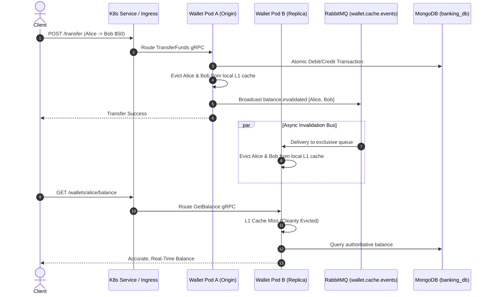
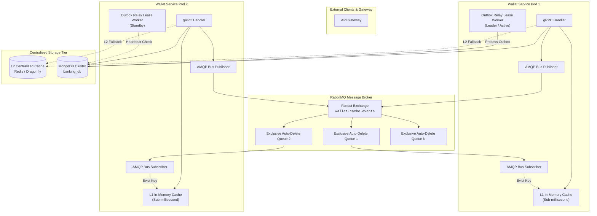

# Distributed Caching & Multi-Pod Invalidation Architecture

## 1. Executive Summary & Problem Statement

In a high-scale microservices banking architecture, `wallet-service` is horizontally scaled to $N$ pods to handle thousands of concurrent queries and transfers. 

### The Multi-Pod Stale Read Hazard
Previously, each `wallet-service` pod maintained an isolated, in-memory `BalanceCache`. When balance mutations occurred (e.g. `TransferFunds` or `FreezeWallet`):
1. **Pod A** processed the transfer and invalidated its own local in-memory cache.
2. **Pod B** and **Pod C** retained stale cached balances for the sender and recipient until their TTLs expired.
3. If an end-user queried their balance immediately following a transfer and their HTTP request was routed by Kubernetes service load balancing to **Pod B**, the user observed a **stale balance**.



### The Multi-Pod Outbox Polling Race
When multiple pods run the transactional outbox relay (`LedgerRelay`), multiple workers query MongoDB for pending ledger entries concurrently. Without coordination:
* Redundant duplicate queries and lock contention occur on MongoDB.
* Duplicate RPC calls to `ledger-service` increase network and CPU overhead.
* **Solution**: Distributed Leader Lease mechanism where only the elected worker pod processes outbox tasks.

---

## 2. Architectural Blueprint

The architecture implements a **Tiered (Hybrid L1/L2) Cache with AMQP Invalidation Bus**:



---

## 3. Core Components

### 3.1 AMQP Distributed Invalidation Bus (`pkg/cache/invalidation_bus.go`)
* **Exchange Name**: `wallet.cache.events`
* **Exchange Type**: `fanout` (durable, non-exclusive)
* **Queue Topology**:
  * Each pod declares a transient, exclusive queue named `wallet.cache.invalidation.<instance_id>`.
  * The queue is bound to `wallet.cache.events` and automatically deletes upon pod termination (`auto-delete: true`).
* **Message Payload**:
  ```json
  {
    "event": "balance.invalidated",
    "wallet_ids": ["wallet-1001", "wallet-1002"],
    "timestamp": 1729000000000,
    "origin_instance_id": "wallet-primary-7c858df-k82p"
  }
  ```
* **Deduplication / Echo Suppression**:
  * The publishing pod includes its `origin_instance_id`.
  * The subscriber ignores events originating from its own instance ID because the local cache was already synchronously invalidated during write execution.

### 3.2 Pluggable Distributed Cache Interface (`pkg/cache/cache.go`)
To support standalone in-memory, centralized Redis, or hybrid configurations, all caching logic implements:

```go
type DistributedCache interface {
    Get(ctx context.Context, walletID string) (*walletv1.GetBalanceResponse, bool, error)
    Set(ctx context.Context, walletID string, resp *walletv1.GetBalanceResponse, ttl time.Duration) error
    Invalidate(ctx context.Context, walletIDs ...string) error
    Close() error
}
```

* **L1 Driver (`MemoryCache`)**: Ultra-fast local in-memory hashmap with TTL, eviction, and mutex concurrency controls.
* **L2 Driver (`RedisCache`)**: Centralized Redis or Dragonfly cache using Redis keys `wallet:balance:{wallet_id}` with binary protobuf serialization for compact storage and minimal serialization overhead.
* **Tiered Driver (`TieredCache`)**: Coordinates L1 + L2 + AMQP Invalidation Bus:
  1. `Get`: Checks L1 in-memory first ($<0.1\text{ ms}$). If miss, checks L2 Redis ($<1\text{ ms}$). If hit in L2, back-fills L1.
  2. `Set`: Populates both L1 and L2 with configured TTL.
  3. `Invalidate`: Evicts from L1, evicts from L2, and publishes invalidation event to AMQP bus.

### 3.3 Distributed Outbox Relay Worker Lease (`RelayLeaseManager`)
To prevent concurrent polling contention across multiple pods:
* **Lease Collection**: `ledger_relay_lease` in MongoDB.
* **Lease Document Schema**:
  ```json
  {
    "_id": "ledger_outbox_relay",
    "holder_id": "wallet-primary-7c858df-k82p",
    "acquired_at": "2026-10-15T12:00:00Z",
    "expires_at": "2026-10-15T12:00:15Z"
  }
  ```
* **Atomic Acquisition**: Uses `FindOneAndUpdate` with criteria:
  $$\text{holder\_id} = \text{myID} \quad \lor \quad \text{expires\_at} < \text{Now()}$$
* If lease acquisition succeeds, the worker executes `ProcessBatch()`.
* If lease acquisition fails, the worker sleeps and acts as a hot standby, ready to acquire leadership within $\le 15\text{ seconds}$ if the active leader fails.

---

## 4. Configuration Reference

| Environment Variable | Default | Description |
|---|---|---|
| `WALLET_CACHE_ENABLED` | `true` | Enables or disables caching layer |
| `WALLET_CACHE_BACKEND` | `hybrid` | Cache backend: `memory`, `redis`, or `hybrid` |
| `WALLET_CACHE_TTL_SECONDS` | `15` | Default cache expiration TTL |
| `WALLET_CACHE_MAX_ENTRIES` | `10000` | Maximum entries for local L1 cache |
| `REDIS_ADDR` | `""` | Redis host:port (e.g. `localhost:6379`) |
| `REDIS_PASSWORD` | `""` | Redis password (optional) |
| `REDIS_DB` | `0` | Redis database index |
| `RABBITMQ_URL` | `amqp://...` | RabbitMQ connection URI for invalidation bus |
| `WALLET_CACHE_EXCHANGE` | `wallet.cache.events` | RabbitMQ fanout exchange for invalidation events |
| `OUTBOX_LEASE_TTL_SECONDS` | `10` | Heartbeat TTL for Outbox Relay leadership lease |
