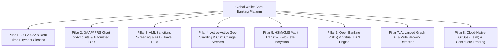
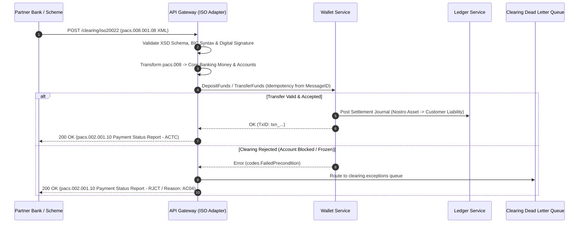
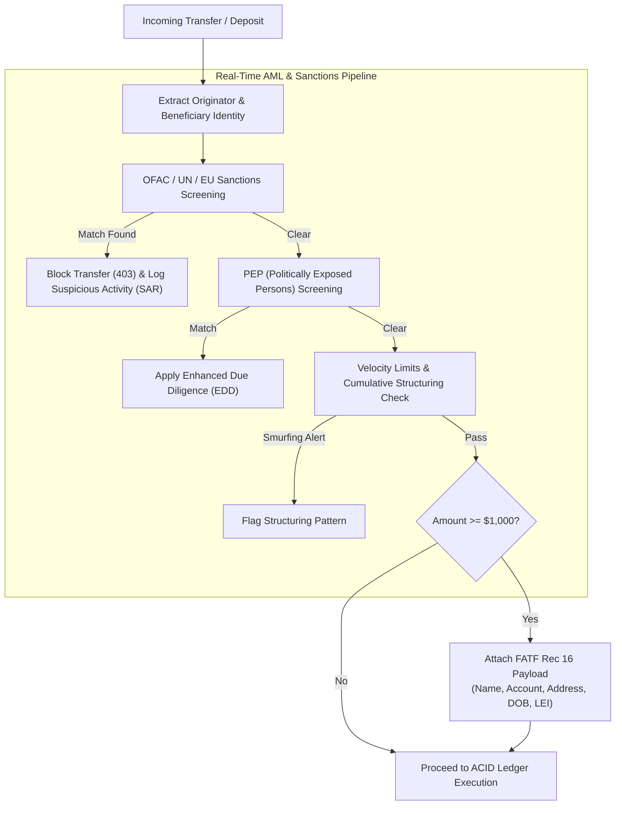
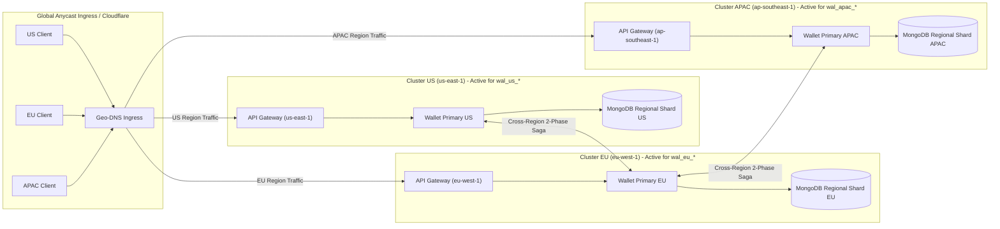
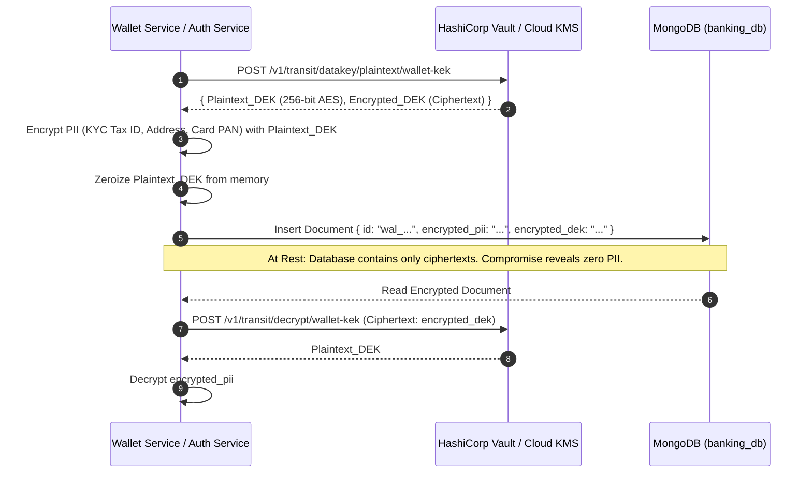
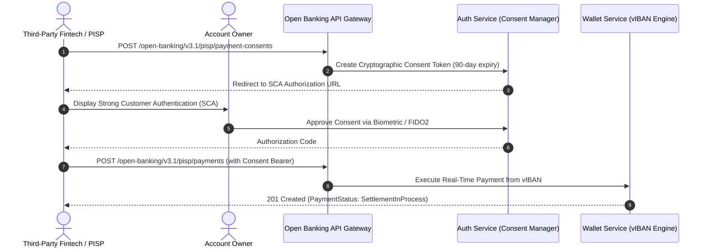
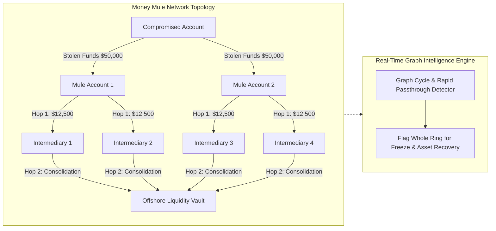
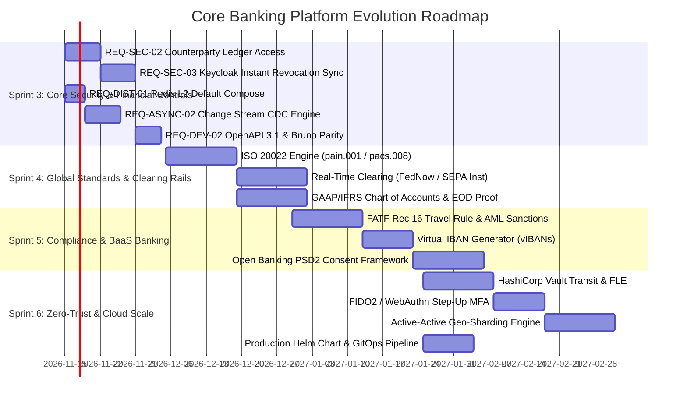

# Global Banking Standards & Architectural Enhancement Roadmap
## Global Multi-Currency Digital Wallet & Double-Entry Ledger Microservices Platform

- **Document Reference**: `docs/GLOBAL_BANKING_STANDARDS_AND_ENHANCEMENT_ROADMAP.md`  
- **Baseline Version**: `v1.9.0` (GA)  
- **Target Standards**: ISO 20022, ISO 4217, GAAP / IFRS, Basel III, FATF Travel Rule, PCI-DSS v4.0, OWASP API Top 10 (2023), CNCF Cloud Native  
- **Status**: Definitive Architectural Engineering Specification  
- **Date**: November 2026  

---

## 1. Executive Summary & Context

With the delivery of **Release v1.9.0** (Sprint 2), the Global Wallet platform has achieved robust distributed resilience:
- **Distributed Fencing**: Standby write fencing across 100% of mutation RPCs and admin APIs (`REQ-DIST-03`).
- **High Availability**: AMQP invalidation bus auto-reconnect with full-jitter exponential backoff and degraded-mode cache TTL (`REQ-DIST-02`).
- **Financial Consistency**: Distributed two-phase compensating Saga for cross-currency FX conversions (`REQ-FIN-02`).
- **Decoupled Messaging**: Asynchronous RabbitMQ partner webhook dispatcher with quorum queues and DLQ (`REQ-ASYNC-01`).
- **Financial Precision**: ISO-4217 decimal scaling and sub-cent/crypto fractional nanos representation (`REQ-FIN-01`).
- **Audit Integrity**: Cryptographic double-entry ledger verification with SHA-256 Merkle root checkpointing (`DEV-03`).
- **Zero-Trust Access**: Broken Object Level Authorization (BOLA/IDOR) data-layer unification (`REQ-SEC-01`).

### The Next Frontier: Transitioning from Microservice Suite to Tier-1 Core Banking Platform
To benchmark the platform against global leaders (such as **Thought Machine Vault**, **Stripe Treasury**, **Wise**, **Form3**, **Griffin**, and **Revolut**), the platform must adopt international banking standards, regulatory compliance protocols, clearing rail integrations, and zero-trust cloud infrastructure.

This document provides a comprehensive audit of the codebase, identifies technical and regulatory gaps, and specifies **8 Strategic Enhancement Pillars** complete with architecture diagrams, data models, and phased delivery plans.

---

## 2. Current State vs. Global Banking Standards: Gap Analysis

```mermaid
radar
    title "Platform Maturity vs. Tier-1 Global Core Banking Standard"
    axes
        Financial Accounting (GAAP/IFRS) : 85, 95
        Payment Rails (ISO 20022 / Clearing) : 35, 90
        Financial Crime & AML (FATF/Sanctions) : 55, 95
        High Availability & Distributed Scale : 80, 95
        Security & Zero-Trust (PCI-DSS / KMS) : 75, 95
        Open Banking & APIs (PSD2 / FDX) : 40, 90
        Developer Tooling & Cloud Native : 85, 95
        AI & Cognitive Operations : 70, 90
```

| Domain | Current Implementation (v1.9.0) | Global Banking Standard / Target | Strategic Gap |
|---|---|---|---|
| **Payment Messaging** | Custom JSON REST & Protobuf RPCs (`TransferFunds`, `DepositFunds`) | **ISO 20022 XML/JSON** (`pain.001`, `pacs.008`, `camt.053`) | Lacks interoperability with SWIFT MX, FedNow, and SEPA clearing rails. |
| **Payment Clearing** | Emulated internal deposit/withdraw rails (`ACH`, `SEPA`, `WIRE`, `CARD`) | Real-time clearing adapters with asynchronous settlement notifications (`pacs.002`) | No clearing cycle lifecycle, cut-off windows, or clearing return handlers (`pacs.004`). |
| **Chart of Accounts** | Basic 4-account types: `CUSTOMER_LIABILITY`, `SETTLEMENT_ASSET`, `FEE_EXPENSE`, `FEE_REVENUE` | **Multi-Tier Chart of Accounts (COA)** per GAAP / IFRS with Nostro/Vostro, safeguarding, and capital reserves | Lacks multi-tier GL hierarchy, automated End-of-Day (EOD) trial balance proof, and balance sheet generation. |
| **Anti-Money Laundering** | Basic KYC tier velocity limits and Gemini transfer scoring | **FATF Recommendation 16 (Travel Rule)**, Real-time OFAC/UN Sanctions screening, and automated SAR filing | Originator/Beneficiary legal identity payloads are missing from high-value transfers; no automated PEP screening. |
| **Multi-Tenancy** | Single-tenant wallet identifiers (`wal_...`) | **Banking-as-a-Service (BaaS) Virtual IBANs (vIBANs)** per ISO 13616 | B2B fintech partners cannot assign dedicated virtual accounts to end customers for inbound clearing routing. |
| **Multi-Region Scale** | Active-Passive standby replica with mutation write fencing | **Active-Active Geo-Sharded Architecture** with deterministic home-region routing | Writes are restricted to a single primary region; multi-region active writes are not yet supported. |
| **Secret Management** | Environment variables & local disk certificates (`/certs`) | **Cloud KMS / HashiCorp Vault Transit Engine** envelope encryption | Keys are static; no automated rotation, HSM backing, or field-level database encryption (FLE). |
| **Authentication** | Keycloak OIDC JWT with offline JWKS verification | **FIDO2 / WebAuthn Step-Up MFA** + Backchannel Logout Sync (`REQ-SEC-03`) | Privileged operations lack step-up challenges; revoked sessions stay valid until JWT expiration. |

---

## 3. The 8 Strategic Enhancement Pillars



---

### Pillar 1: ISO 20022 Financial Messaging & Real-Time Clearing Rails

#### 1.1 Problem & Industry Context
Modern interbank payment networks have globally mandated ISO 20022 message formats:
- **FedNow & RTP (US)**: Mandate `pacs.008` (Financial Institutional Customer Credit Transfer) and `pain.013` (Creditor Payment Activation).
- **SEPA (EU / UK)**: European Payments Council (EPC) mandates ISO 20022 for SEPA Credit Transfer (SCT) and SEPA Instant (SCT Inst).
- **SWIFT MX**: Worldwide migration from legacy MT format to MX (ISO 20022) completed in 2025/2026.

Currently, the platform's API Gateway communicates using proprietary JSON payloads. External fintech partners cannot ingest or initiate standardized financial messages.

#### 1.2 Architectural Specification
Introduce a dedicated **Clearing Ingestion & Normalization Adapter** within `api-gateway` and `wallet-service`:



#### 1.3 Key Features to Implement:
1. **ISO 20022 Parser & Serializer (`pkg/iso20022`)**:
   - `pain.001.001.09`: Customer Credit Transfer Initiation (B2B corporate payroll and bulk payments).
   - `pacs.008.001.08`: Financial Institution Customer Credit Transfer (clearing network ingestion).
   - `pacs.002.001.10`: Payment Status Report (positive confirmation `ACTC` or rejection `RJCT` with standard ISO error codes: `AC01` incorrect account, `AC04` closed account, `AM04` insufficient funds).
   - `camt.053.001.08`: Bank-to-Customer Cash Management End-of-Day Statement.
2. **Payment Clearing Rail Drivers**:
   - **FedNow / RTP Adapter**: 24/7/365 immediate availability with sub-second clearing execution.
   - **SEPA Instant Adapter**: Adherence to the 10-second rule with IBAN checksum validation (mod 97-10 algorithm).
   - **ACH Batch Processor**: Multi-file NACHA format generator with 9:00 AM / 1:00 PM / 5:00 PM ET cutoff window scheduling.

---

### Pillar 2: GAAP / IFRS Multi-Tier Chart of Accounts & Automated End-of-Day (EOD)

#### 2.1 Problem & Industry Context
`cmd/ledger-service/double_entry.go` currently enforces fundamental double-entry balance ($\sum \text{Debits} == \sum \text{Credits}$). However, core banking institutions require a multi-tiered **Chart of Accounts (COA)** that segregates safeguarded funds, liquidity reserves, and fee income for regulatory reporting (FINREP / COREP under Basel III).

Furthermore, the ledger currently runs continuously without formal **End-of-Day (EOD) cutoff windows**, making point-in-time balance sheet snapshots difficult to certify for external auditors.

#### 2.2 Architectural Specification: Multi-Tier Chart of Accounts Hierarchy
```
1000 - ASSETS (Debit Normal)
  ├── 1100 - Central Bank Reserves (Federal Reserve / ECB Settlement Accounts)
  ├── 1200 - Nostro Accounts (Commercial Banks: Barclays, J.P. Morgan, Citi)
  │     ├── 1210 - Nostro USD Operating Account
  │     ├── 1220 - Nostro EUR Operating Account
  │     └── 1230 - Nostro GBP Operating Account
  ├── 1300 - Payment Scheme Clearing Receivables (Visa, Mastercard, ACH, SEPA)
  └── 1400 - FX Liquidity Buffer Assets

2000 - LIABILITIES (Credit Normal)
  ├── 2100 - Customer Demand Deposits (Total Wallet Balances)
  │     ├── 2110 - Retail Customer Wallets
  │     └── 2120 - Corporate / Merchant Wallets
  ├── 2200 - Safeguarded Client Funds (FCA/EBA Ring-Fenced Statutory Trust)
  └── 2300 - Inbound Clearing Suspense & Unallocated Funds

3000 - EQUITY & CAPITAL RESERVES (Credit Normal)
  ├── 3100 - Paid-In Regulatory Capital
  └── 3200 - Basel III Capital Conservation Buffer

4000 - REVENUE (Credit Normal)
  ├── 4100 - Transaction Processing Fee Revenue
  ├── 4200 - FX Conversion Spread Margins
  └── 4300 - Interchange Sharing Revenue

5000 - EXPENSES (Debit Normal)
  ├── 5100 - Card Scheme Interchange & Network Assessment Costs
  ├── 5200 - Banking-as-a-Service Core Clearing Costs
  └── 5300 - FX Liquidity Provider Spread Expenses
```

#### 2.3 Automated End-of-Day (EOD) Reconciliation Engine
1. **Daily Cutoff Window Scheduler**:
   - At `00:00:00 UTC`, the ledger triggers an atomic EOD checkpoint.
   - Computes rolling trial balance across all General Ledger (GL) accounts.
   - Enforces the invariant:
     $$\sum \text{Assets (1000s)} = \sum \text{Liabilities (2000s)} + \sum \text{Equity (3000s)} + \left(\sum \text{Revenue (4000s)} - \sum \text{Expenses (5000s)}\right)$$
2. **Automated Statement of Financial Position Generation**:
   - Exports certified balance sheets and income statements in JSON, CSV, and `camt.053` XML formats.
   - Generates daily Merkle root audit proofs anchored into public verifiable ledgers or cloud immutability vaults.
3. **Nostro-Vostro Automated Reconciliation (Break Detector)**:
   - Ingests partner bank MT940 / `camt.053` bank statements.
   - Matches internal ledger settlement postings against external bank credits.
   - Unmatched transactions $> 24$ hours old automatically generate high-priority alerting tickets for Treasury Operations.

---

### Pillar 3: AML Sanctions Screening, PEP & FATF Travel Rule Engine

#### 3.1 Problem & Industry Context
Under **Financial Action Task Force (FATF) Recommendation 16** (the "Travel Rule"), financial institutions must transmit originator and beneficiary information alongside cross-border and virtual asset transfers exceeding $1,000 / €1,000. 

Additionally, banking regulations (OFAC, FinCEN, EU 2015/847) require real-time sanctions screening prior to funds movement. Currently, `wallet-service` verifies only rolling KYC velocity limits, leaving the platform vulnerable to sanctions compliance risks.

#### 3.2 Architectural Specification: Travel Rule & Real-Time AML Pipeline


#### 3.3 Key Features to Implement:
1. **Real-Time Screening Engine (`pkg/compliance/sanctions`)**:
   - In-memory Aho-Corasick / Levenshtein fuzzy string matching against consolidated sanctions lists:
     - US OFAC Specially Designated Nationals (SDN).
     - United Nations Consolidated Sanctions.
     - EU Financial Sanctions Database.
   - Zero-latency caching ($< 5\text{ms}$ overhead on transfer path).
2. **Travel Rule Identity Contract (`proto/wallet/compliance.proto`)**:
   ```protobuf
   message TravelRuleParty {
     string full_legal_name = 1;
     string account_number_or_iban = 2;
     string physical_address = 3;
     string national_identity_number = 4; // Passport / SSN / Tax ID
     string date_of_birth = 5;            // YYYY-MM-DD
     string country_of_incorporation = 6;  // ISO-3166-1 alpha-2
     string legal_entity_identifier = 7;   // 20-character LEI code
   }

   message TravelRulePayload {
     string transfer_reference = 1;
     TravelRuleParty originator = 2;
     TravelRuleParty beneficiary = 3;
     string regulatory_jurisdiction = 4;
   }
   ```
3. **Automated SAR (Suspicious Activity Report) Generator**:
   - Detects structuring/smurfing behavior (e.g. 5 transactions of $9,950 within 48 hours to evade the $10,000 FinCEN reporting threshold).
   - Generates FinCEN-compliant XML SAR payloads ready for compliance officer signoff.

---

### Pillar 4: Multi-Region Active-Active Geo-Sharding & CDC Outbox Engine

#### 4.1 Problem & Industry Context
In `v1.9.0`, high availability is delivered via **Active-Passive Standby** with mutation write fencing (`REQ-DIST-03`). While this guarantees 100% split-brain safety, secondary regions cannot accept mutation traffic, leaving secondary hardware underutilized and incurring inter-region network latency for global users transacting far from the primary datacenter.

Furthermore, `wallet-service` currently polls MongoDB for outbox events (`REQ-ASYNC-02`), consuming database read IOPS.

#### 4.2 Architectural Specification: Geo-Partitioned Active-Active Sharding


#### 4.3 Key Features to Implement:
1. **Deterministic Home-Region Routing**:
   - Every wallet belongs to an authoritative home region encoded in the account identifier (e.g. `wal_us_1002`, `wal_eu_2004`, `wal_ap_3008`).
   - Mutations on `wal_us_*` execute locally in `us-east-1` with single-digit millisecond latency.
   - If an EU client initiates a transfer from `wal_eu_*` to `wal_us_*`, the EU cluster acts as the Saga coordinator.
2. **MongoDB Change Streams (Zero-Polling Outbox Engine `REQ-ASYNC-02`)**:
   - Replace timer-based polling (`time.NewTicker`) in `ledger_outbox.go` and `pkg/observability/outbox.go` with native **MongoDB Change Streams** (`col.Watch(ctx, pipeline)`).
   - Instantaneous event dispatching over RabbitMQ with zero query load on MongoDB primary.
   - Resilient resume tokens (`resumeAfter`) to guarantee zero event loss across network interruptions.

---

### Pillar 5: Zero-Trust HSM / KMS Vault Transit & Field-Level Encryption (FLE)

#### 5.1 Problem & Industry Context
Financial regulators (PCI-DSS v4.0 Requirement 3, GDPR Article 32, HIPAA) mandate that Personally Identifiable Information (PII) and Primary Account Numbers (PAN) must be encrypted at rest with keys protected by dedicated **Hardware Security Modules (HSM)** or managed Cloud KMS, preventing database administrators or compromised database dumps from reading plaintext customer records.

Currently, keys and secrets are loaded via environment variables and stored in memory.

#### 5.2 Architectural Specification: Envelope Encryption with HashiCorp Vault Transit Engine


#### 5.3 Key Features to Implement:
1. **HashiCorp Vault Transit Engine Integration (`pkg/crypto/vault`)**:
   - Envelope encryption for sensitive fields: Customer tax IDs, SSNs, bank account numbers, and HMAC webhook secrets.
   - Automated annual key rotation with Vault key versioning (`/transit/keys/wallet-kek/rotate`).
2. **FIDO2 / WebAuthn Step-Up Authentication Engine**:
   - Configurable risk-based step-up authentication policy:
     - Any single transfer $> \$5,000$.
     - Any transfer with Gemini AI fraud score $> 0.60$.
     - Changes to destination bank account details or KYC profile.
   - Generates WebAuthn challenge verifying user biometric or hardware security key (YubiKey / TouchID / Windows Hello) prior to transaction commit.
3. **Keycloak Backchannel Logout & Instant Revocation Sync (`REQ-SEC-03`)**:
   - Implement `POST /auth/backchannel-logout` in `auth-service` to immediately invalidate active JWTs in the Gateway cache when an administrator disables an account in Keycloak.

---

### Pillar 6: Open Banking (PSD2 / Open Banking UK / FDX) & Virtual IBAN Engine

#### 6.1 Problem & Industry Context
Under European PSD2 / UK Open Banking regulations and US Financial Data Exchange (FDX) standards, licensed fintechs and banks must expose standardized interfaces for:
1. **Account Information Service Providers (AISP)**: Read-only access to accounts, balances, and historical transaction statements with fine-grained customer consent.
2. **Payment Initiation Service Providers (PISP)**: Account-to-account credit transfer initiation without needing intermediaries or payment cards.
3. **Virtual Account Management (vIBANs)**: Issuing unique, routable international bank account numbers so corporate clients can segregate client funds and automate ledger reconciliation.

#### 6.2 Architectural Specification: Virtual IBAN Lifecycle & Open Banking Consent


#### 6.3 Key Features to Implement:
1. **Virtual IBAN Generator (`pkg/banking/iban`)**:
   - Generates compliant ISO 13616 IBANs with verifiable check digits:
     - UK Sort Code & Account Number formatting (`GBxx BARK 200000 12345678`).
     - German BLZ formatting (`DExx 3704 0044 0532 0130 00`).
     - French BIC/IBAN formatting (`FRxx 3000 2005 5012 3456 7890 123`).
   - Links inbound vIBAN clearing events directly to specific sub-pots or customer balances.
2. **Open Banking Consent Lifecycle API**:
   - Dedicated endpoints: `GET /open-banking/accounts`, `GET /open-banking/balances`, `POST /open-banking/payments`.
   - Granular scope enforcement: `ReadAccountsDetail`, `ReadBalances`, `ReadTransactionsDetail`, `CreatePaymentInitiation`.
   - Automatic consent expiration and customer revocation portal.

---

### Pillar 7: Graph-Based Mule Network Detection & Conversational Banking AI

#### 7.1 Problem & Industry Context
`v1.9.0` includes Google Gemini AI for heuristic fraud evaluation on single transactions (`pkg/ai/fraud_detector.go`). However, sophisticated financial syndicates operate via **money mule networks**: funds are rapidly layered through dozens of newly opened, seemingly legitimate accounts in small, randomized amounts before being consolidated and withdrawn.

Single-transaction evaluations cannot detect distributed money laundering topologies without structural graph context.

#### 7.2 Architectural Specification: Graph Anomaly Detection Engine


#### 7.3 Key Features to Implement:
1. **Real-Time Mule Ring Detector (`pkg/ai/graph`)**:
   - Evaluates transfer topology within rolling 72-hour windows:
     - **Fan-Out / Fan-In Factor**: One account distributing funds to 10+ accounts that reconsolidate within 2 hours.
     - **Zero Retention Velocity**: Accounts retaining funds for $< 180\text{ seconds}$ before forwarding.
     - **Circular Transactions**: Account $A \to B \to C \to A$ (wash trading / artificial volume inflation).
2. **Conversational Financial Copilot (Gemini Interactions API)**:
   - Natural language queries for retail users: *"How much did I spend on dining out in EUR last month vs this month?"*, *"What would my balance look like if I convert all JPY to USD today?"*
   - Real-time Treasury insights for operators: *"Show all currency pairs where liquidity reserve is below 20% of 24h rolling volume."*
   - Automated enrichment of merchant descriptions into clean logos, category tags, and carbon footprint estimates.

---

### Pillar 8: Cloud-Native GitOps (Helm / ArgoCD) & Continuous Profiling

#### 8.1 Problem & Industry Context
The project currently manages Kubernetes deployments using individual raw manifest files in `k8s/` (`01-namespace.yaml` through `13-redis.yaml`). Raw manifests lack parameterized environment separation (`dev`, `staging`, `prod`), canary rollout definitions, and automated GitOps synchronization.

In high-frequency core banking, unexpected garbage collection pauses or goroutine leaks can cause SLA breaches in payment clearing windows.

#### 8.2 Architectural Specification: Production Helm Chart & GitOps Pipeline
```
deploy/helm/global-wallet/
  ├── Chart.yaml
  ├── values.yaml                     # Default development values
  ├── values-staging.yaml             # Staging cluster configuration
  ├── values-production.yaml          # Multi-zone production values with HA
  ├── templates/
  │   ├── _helpers.tpl
  │   ├── configmap-secrets.yaml
  │   ├── api-gateway-deployment.yaml
  │   ├── wallet-service-deployment.yaml
  │   ├── ledger-service-deployment.yaml
  │   ├── auth-service-deployment.yaml
  │   ├── fx-service-deployment.yaml
  │   ├── logging-service-deployment.yaml
  │   ├── redis-statefulset.yaml
  │   ├── rabbitmq-cluster.yaml
  │   ├── ingress.yaml
  │   ├── hpa.yaml
  │   └── pod-disruption-budgets.yaml
```

#### 8.3 Key Features to Implement:
1. **Production Helm Chart & ArgoCD Application**:
   - Single command deployment: `helm upgrade --install wallet deploy/helm/global-wallet -f deploy/helm/global-wallet/values-production.yaml`.
   - ArgoCD Application manifest for declarative GitOps synchronization with automated drift detection and self-healing.
2. **Canary & Blue-Green Progressive Delivery (Argo Rollouts)**:
   - Automated traffic shifting on new releases: 5% $\to$ 20% $\to$ 50% $\to$ 100% with automated rollback if 5xx error rate exceeds 0.1% or latency p99 exceeds 200ms.
3. **Continuous Profiling Integration (Pyroscope / Grafana Tempo)**:
   - Low-overhead continuous CPU, heap memory, and goroutine profiling across all microservices to identify performance bottlenecks and memory bloat under peak clearing volume.

---

## 4. Prioritized Engineering Roadmap (Sprints 3 through 6)



---

## 5. Summary Matrix of Proposed Capabilities

| Pillar | Feature Name | Global Benchmark | Target Microservice | Business & Technical Value |
|:---:|---|---|:---:|---|
| **1** | **ISO 20022 Clearing Engine** | SWIFT MX / FedNow / SEPA | `api-gateway`, `wallet-service` | Enables direct institutional clearing integration with Tier-1 banking partners without intermediary translators. |
| **2** | **Multi-Tier GAAP/IFRS Chart of Accounts** | Basel III / Thought Machine | `ledger-service` | Segregates customer liabilities from safeguarded trust funds; automated daily balance sheets and trial balances. |
| **3** | **FATF Travel Rule & Sanctions Screening** | FATF Rec 16 / OFAC SDN | `wallet-service`, `pkg/compliance` | Automated regulatory compliance for cross-border transactions $> \$1,000$; zero-latency sanctions matching. |
| **4** | **Active-Active Geo-Sharding** | Stripe Treasury / Wise | `wallet-service`, `api-gateway` | Sub-10ms local transaction latency for global users; multi-region write availability with 2-phase Saga. |
| **5** | **Vault Transit Envelope Encryption** | PCI-DSS v4.0 / AWS KMS | `auth-service`, `wallet-service` | Protects customer PII and card PANs at rest; automated annual key rotation without database re-encryption. |
| **6** | **Virtual IBAN (vIBAN) Management** | Revolut / Form3 | `wallet-service`, `api-gateway` | Empowers B2B fintech partners to assign dedicated European and UK virtual IBANs for automated reconciliation. |
| **7** | **Graph-Based Money Mule Detection** | Vertex AI / Featurespace | `pkg/ai` | Stops multi-hop money laundering rings and smurfing attacks across newly funded account topologies. |
| **8** | **Production Helm & ArgoCD GitOps** | CNCF Cloud Native | `deploy/helm`, CI/CD | One-command multi-environment cloud deployment with automated canary progressive traffic delivery. |

---

## 6. Conclusion & Recommendation

With **Sprint 1 (`v1.8.0`)** and **Sprint 2 (`v1.9.0`)** successfully completed, the platform's distributed foundation (fencing, caching, compensating Sagas, and decoupled queues) is solid and verified.

**Recommended Next Step**:
Proceed immediately with **Sprint 3**, completing the remaining items from [`docs/PENDING_REQUIREMENTS_AND_ARCHITECTURE_SPEC.md`](PENDING_REQUIREMENTS_AND_ARCHITECTURE_SPEC.md):
1. **`REQ-SEC-02`**: Counterparty Ledger Journal Access Control.
2. **`REQ-SEC-03`**: Keycloak Backchannel Logout & Instant Token Revocation Sync.
3. **`REQ-DIST-01`**: Redis L2 Default Compose Integration.
4. **`REQ-ASYNC-02`**: Single Outbox Change Stream (CDC) Engine.
5. **`REQ-DEV-02`**: OpenAPI 3.1 & Bruno E2E Suite Contract Parity.

Following Sprint 3, the platform will be primed to execute **Sprint 4 (ISO 20022 & Real-Time Clearing Rails)**, establishing true Tier-1 core banking capability.
