# Next-Level Architectural & Operational Improvement Roadmap

**Project**: Global Multi-Currency Digital Wallet & Ledger Service  
**Status**: In Progress  
**Last Updated**: October 2026  

---

## 1. Executive Summary & Purpose

Following the successful completion of the **Production Readiness Audit** (Phases 1–4, covering ACID transactional outbox, zero-trust mTLS, high-availability failover consensus, OpenTelemetry tracing, and cryptographic double-entry ledger verification), this roadmap defines the next evolution of the platform.

The goal is to elevate the platform from a single-cluster microservice suite to an enterprise-grade global banking core with:
1. **100% Cloud-Native & Kubernetes Completeness** across all 6 microservices + Keycloak IdP.
2. **Distributed Cache Invalidation & Resilient Leasing** for horizontal scale.
3. **Resilience, Circuit Breaking & Graceful Fallback** under network partitioning.
4. **Core Banking & Financial Product Capabilities** (Multi-currency pots, payment rails, velocity limits).
5. **Developer Experience, API Governance & External Compliance** (Swagger/OpenAPI, Merkle root checkpointing, operational CLI).

---

## 2. Strategic Pillars & Workstreams

```mermaid
graph TD
    A[Global Wallet Platform] --> P1[Pillar 1: Kubernetes & GitOps Completeness]
    A --> P2[Pillar 2: Distributed Caching & Event Bus]
    A --> P3[Pillar 3: Resilience & Circuit Breaking]
    A --> P4[Pillar 4: Core Banking & Product Expansion]
    A --> P5[Pillar 5: Developer Experience & Compliance]

    P1 --> K1[Auth & FX Manifests]
    P1 --> K2[Ingress & Secret Unification]
    P1 --> K3[HPA & PDB Coverage]

    P2 --> C1[AMQP Invalidation Bus]
    P2 --> C2[L2 Redis Adapter]
    P2 --> C3[Distributed Outbox Lease]

    P3 --> R1[Sony Gobreaker on Inter-Service RPCs]
    P3 --> R2[FX Provider Stale Fallbacks]
    P3 --> R3[Adaptive Rate Limiting]

    P4 --> B1[Multi-Currency Pots per Wallet]
    P4 --> B2[Velocity Limits Engine]
    P4 --> B3[Deposit & Withdraw External Rails]

    P5 --> D1[OpenAPI 3.0 & Swagger UI]
    P5 --> D2[Unified CLI walletctl]
    P5 --> D3[Merkle Root Ledger Checkpoints]
```

---

## 3. Detailed Progress Tracker & Checklist

### Pillar 1: Kubernetes & Cloud-Native Completeness
*Focus: Ensure every microservice, identity provider, and route has enterprise K8s manifests.*

- [x] **K8S-01: Standalone `auth-service` & `keycloak` Manifests (`k8s/11-auth-service.yaml`)**
  - [x] ConfigMap for `wallet-realm-realm.json` OIDC realm import.
  - [x] Keycloak StatefulSet/Deployment & ClusterIP service on `:8085`.
  - [x] Non-root `auth-service` Deployment (2 replicas, ports `50054` & `9095`).
  - [x] Liveness (`/healthz`) and readiness probes on management port `:9095`.
  - [x] ClusterIP service for internal gRPC & metrics routing.
- [x] **K8S-02: Standalone `fx-service` Manifests (`k8s/12-fx-service.yaml`)**
  - [x] Deployment with 2 replicas running `wallet-system/fx-service:latest`.
  - [x] Port exposure: `50055` (gRPC), `8086` (B2B HTTP REST), `9096` (Metrics/Health).
  - [x] Non-root security context (`10001:10001`, `drop: ["ALL"]`, `allowPrivilegeEscalation: false`).
  - [x] Probes on `:9096/healthz`.
  - [x] ClusterIP service mapping gRPC, HTTP, and metrics ports.
- [x] **K8S-03: Inter-Service Service Discovery & Wiring Updates**
  - [x] Update `k8s/04-wallet-services.yaml` with `FX_SERVICE_ADDR: "fx-service:50055"`.
  - [x] Update `k8s/05-api-gateway.yaml` with `AUTH_SERVICE_ADDR: "auth-service:50054"` and `FX_SERVICE_ADDR: "fx-service:50055"`.
- [x] **K8S-04: Ingress & Edge Routing Expansion (`k8s/08-ingress.yaml`)**
  - [x] Expose Keycloak authentication endpoints (`/auth`, `/realms`).
  - [x] Expose FX Engine B2B endpoints (`/api/v1/fx/b2b`).
  - [x] Ensure TLS termination and routing rules are configured.
- [x] **K8S-05: ConfigMap, Secrets & Autoscaling (`k8s/09-configmap-secrets.yaml`, `k8s/10-hpa-pdb.yaml`)**
  - [x] Inject FX default spreads, sync intervals, and provider keys.
  - [x] Inject Auth credentials, Keycloak secrets, and client IDs.
  - [x] Add HPA (`minReplicas: 2`, `maxReplicas: 6`) for `auth-service` and `fx-service`.
  - [x] Add PDB (`minAvailable: 1`) for `auth-service` and `fx-service`.
- [x] **K8S-06: `auth-service` Management & Observability Harmonization**
  - [x] Add HTTP management server on `METRICS_PORT` (`:9095`) with `/metrics` and `/healthz`.
  - [x] Update `monitoring/prometheus.yml` scrape configs for `auth-service` (:9095) and `fx-service` (:9096).
- [x] **K8S-07: CI/CD Pipeline Local Kubernetes Autodeployment**
  - [x] Add `deploy-k8s` dedicated stage to `.github/workflows/ci.yml` running on self-hosted Windows runner.
  - [x] Add automated image tagging (`wallet-system/...:latest`) for cluster pod caching.
  - [x] Implement deterministic dependency-ordered rollout with rolling restart and status checks.
  - [x] Create standalone deployment scripts: `scripts/deploy-k8s.bat` (Windows) and `scripts/deploy-k8s.sh` (Linux/macOS).
  - [x] Add `make k8s-deploy`, `make k8s-status`, and `make k8s-down` Makefile targets.
- [x] **K8S-08: Enterprise Helm Chart Packaging (`deploy/helm/global-wallet`)**
  - [x] Create modular `Chart.yaml` and `values.yaml` with global settings and pod security contexts.
  - [x] Create environment overlays: `values-staging.yaml` and `values-prod.yaml`.
  - [x] Package templates for all 6 microservices, Keycloak IdP, MongoDB ReplicaSet, RabbitMQ broker, Ingress, HPAs, and PDBs.
  - [x] Add Makefile targets `helm-lint`, `helm-template`, `helm-install`, and `helm-uninstall`.
  - [x] Pass all `helm lint` and `helm template` verifications.

---

### Pillar 2: Distributed Caching & Event Bus
*Focus: Scale `wallet-service` to N horizontal pods with zero stale read hazards.*

- [x] **DIST-01: AMQP Distributed Cache Invalidation Bus**
  - [x] Declare RabbitMQ fanout exchange `wallet.cache.events`.
  - [x] Implement publisher in `wallet-service` emitting `balance.invalidated` on balance mutating operations.
  - [x] Implement subscriber in `wallet-service` invalidating local `BalanceCache` across all replica pods.
  - [x] Implement echo suppression via `origin_instance_id`.
- [x] **DIST-02: Pluggable L2 Redis / Dragonfly Cache Backend**
  - [x] Implement `DistributedCache` interface supporting in-memory, Redis, or hybrid tiered backends (`pkg/cache/cache.go`, `redis.go`, `tiered.go`).
  - [x] Add TTL and cache key invalidation with binary protobuf serialization.
  - [x] Add Docker Compose (`docker-compose.redis.yml`) and Kubernetes manifests (`k8s/13-redis.yaml`).
- [x] **DIST-03: Distributed Outbox Relay Worker Lease**
  - [x] Add advisory lock / lease mechanism (`RelayLeaseManager`) in MongoDB (`ledger_relay_lease` collection).
  - [x] Implement atomic acquisition via `FindOneAndUpdate` with criteria `holder_id = myID OR expires_at < Now()`.
  - [x] Support graceful shutdown lease release with detached context and thread-safe leader tracking.
  - [x] Unit and race-condition test suite coverage in `cmd/wallet-service/ledger_outbox_unit_test.go`.

---

### Pillar 3: Resilience, Circuit Breaking & Graceful Fallback
*Focus: Prevent cascade failures across network boundaries.*

- [x] **RES-01: Circuit Breaker Interceptors (`sony/gobreaker`)**
  - [x] Add client-side circuit breaking to API Gateway dials for Wallet (Primary & Standby), FX, Ledger, and Auth.
  - [x] Add circuit breaking to `wallet-service` for `ledger-service` and `fx-service` calls.
- [x] **RES-02: Resilient FX Rate Stale Fallback**
  - [x] If upstream rate providers (Frankfurter/ECB) fail or timeout, return last-known good rate marked with `stale_quote: true`.
  - [x] Log warning and emit Prometheus metric `fx_provider_degraded_total`.
- [x] **RES-03: Outbox Relay Exponential Backoff with Jitter**
  - [x] Enhance outbox retry loop with full-jitter exponential backoff on consecutive ledger gRPC errors.

---

### Pillar 4: Core Banking & Financial Product Expansion
*Focus: Support multi-currency wallets, payment rails, and velocity limits.*

- [x] **FIN-01: Multi-Currency Pots per Wallet**
  - [x] Extend `WalletModel` to support balances map `map[string]int64` (e.g. `USD: 10000`, `EUR: 5000`).
  - [x] Enable atomic intra-wallet currency exchanges.
- [x] **FIN-02: Velocity Limits & Compliance Engine**
  - [x] Add configurable 24-hour rolling volume limits and transaction rate caps per user.
  - [x] Support KYC tier enforcement (`TIER_1`, `TIER_2`, `TIER_3`).
- [x] **FIN-03: External Deposit & Withdrawal Rails Simulator**
  - [x] Add `POST /api/v1/wallets/{id}/deposit` (Card/ACH/SEPA/WIRE inbound simulation).
  - [x] Add `POST /api/v1/wallets/{id}/withdraw` (External bank payout simulation).
  - [x] Record corresponding 2-leg external settlement journal entries in `ledger-service`.
- [x] **FIN-04: Outbound Partner Webhook Dispatcher**
  - [x] Support merchant/partner webhook registration (`transfer.completed`, `fraud.flagged`, `deposit.completed`, `withdrawal.completed`).
  - [x] Sign payloads with HMAC-SHA256 (`X-Wallet-Signature`, `X-Wallet-Timestamp`) with replay attack tolerance.
  - [x] Exponential backoff retry engine with full jitter and MongoDB delivery state tracking.
  - [x] RESTful webhook subscription and live endpoint ping test APIs in API Gateway.

---

### Pillar 5: Developer Experience, Tooling & Auditing
*Focus: Seamless operator experience and regulatory audit exports.*

- [ ] **DEV-01: OpenAPI 3.0 & Embedded Swagger UI**
  - [ ] Embed OpenAPI 3.0 definition and Swagger UI into `api-gateway` at `/swagger` and `/docs`.
- [ ] **DEV-02: Unified CLI Utility (`walletctl`)**
  - [ ] Command-line interface in Go for health inspection, token generation, failover drills, and audit verification.
- [ ] **DEV-03: Merkle Root Ledger Checkpoints**
  - [ ] Periodic Merkle root generation over batches of SHA-256 ledger entries for external regulatory attestation.

---

## 4. Current Execution Status: Track 1 (Kubernetes Completeness)

| Manifest / Component | File Path | Status |
|---|---|:---:|
| Auth Service & Keycloak | `k8s/11-auth-service.yaml` | ✅ Complete |
| FX Engine Service | `k8s/12-fx-service.yaml` | ✅ Complete |
| Wallet Service Discovery | `k8s/04-wallet-services.yaml` | ✅ Complete |
| API Gateway Discovery | `k8s/05-api-gateway.yaml` | ✅ Complete |
| Ingress Path Expansion | `k8s/08-ingress.yaml` | ✅ Complete |
| Config & Secrets Unification | `k8s/09-configmap-secrets.yaml` | ✅ Complete |
| Autoscaling & Disruption Budgets | `k8s/10-hpa-pdb.yaml` | ✅ Complete |
| Auth Service Metrics Server | `cmd/auth-service/main.go` | ✅ Complete |
| Prometheus Scrape Targets | `monitoring/prometheus.yml` | ✅ Complete |

---

## 5. Current Execution Status: Track 2 (Distributed Caching & Invalidation)

| Component / Subsystem | File Path | Status |
|---|---|:---:|
| AMQP Invalidation Bus | `pkg/cache/invalidation_bus.go` | ✅ Complete |
| Pluggable Cache Interface & L1 Memory | `pkg/cache/cache.go`, `pkg/cache/memory.go` | ✅ Complete |
| L2 Redis Cache Driver | `pkg/cache/redis.go` | ✅ Complete |
| Tiered L1+L2 Hybrid Orchestrator | `pkg/cache/tiered.go`, `cmd/wallet-service/cache.go` | ✅ Complete |
| Distributed Outbox Relay Worker Lease | `cmd/wallet-service/ledger_outbox.go` | ✅ Complete |
| Unit & Data Race Test Suite | `cmd/wallet-service/ledger_outbox_unit_test.go` | ✅ Complete |
| Redis Local Docker Infrastructure | `docker-compose.redis.yml` | ✅ Complete |
| Redis Kubernetes Deployment & Service | `k8s/13-redis.yaml` | ✅ Complete |
| Architectural Documentation | `docs/DISTRIBUTED_CACHING_ARCHITECTURE.md` | ✅ Complete |

---

## 6. Current Execution Status: Track 3 (Resilience, Circuit Breaking & Graceful Fallback)

| Component / Subsystem | File Path | Status |
|---|---|:---:|
| GoBreaker Circuit Breaker Interceptor | `pkg/resilience/circuit_breaker.go` | ✅ Complete |
| Circuit Breaker Unit & Race Suite | `pkg/resilience/circuit_breaker_test.go` | ✅ Complete |
| API Gateway Dials Circuit Breaker (Auth, Wallet, FX, Ledger) | `cmd/api-gateway/main.go` | ✅ Complete |
| Wallet Service Downstream Breakers (Ledger, FX) | `cmd/wallet-service/main.go` | ✅ Complete |
| Resilient FX Stale Fallback Engine & StaleQuote Flag | `cmd/fx-service/provider.go` | ✅ Complete |
| Prometheus Metric (`fx_provider_degraded_total`) | `pkg/observability/metrics.go` | ✅ Complete |
| FX Stale Fallback Unit & Race Suite | `cmd/fx-service/main_test.go` | ✅ Complete |
| Outbox Relay Full-Jitter Exponential Backoff | `cmd/wallet-service/ledger_outbox.go` | ✅ Complete |
| Outbox Backoff Unit & Race Test Suite | `cmd/wallet-service/ledger_outbox_unit_test.go` | ✅ Complete |

---

## 7. Current Execution Status: Track 4 (Core Banking Expansion - FIN-01)

| Component / Subsystem | File Path | Status |
|---|---|:---:|
| Multi-Currency Protobuf Definition (`ExchangeCurrency`) | `proto/wallet/wallet.proto` | ✅ Complete |
| Wallet Multi-Currency Pots Model (`Balances map[string]int64`) | `cmd/wallet-service/main.go` | ✅ Complete |
| Atomic Intra-Wallet FX Exchange Handler & ACID Flow | `cmd/wallet-service/main.go` | ✅ Complete |
| Double-Entry Intra-Wallet Ledger Outbox Integration | `cmd/wallet-service/main.go` | ✅ Complete |
| API Gateway REST Route (`POST /api/v1/wallets/exchange`) | `cmd/api-gateway/main.go` | ✅ Complete |
| Wallet Service Multi-Currency & Exchange Unit Tests | `cmd/wallet-service/main_unit_test.go` | ✅ Complete |
| API Gateway Exchange Endpoint Unit Tests | `cmd/api-gateway/gateway_routes_unit_test.go` | ✅ Complete |

---

## 8. Current Execution Status: Track 4 (Core Banking Expansion - FIN-02)

| Component / Subsystem | File Path | Status |
|---|---|:---:|
| Protobuf Contracts (`UpdateWalletKYC`, `GetWalletLimits`) | `proto/wallet/wallet.proto` | ✅ Complete |
| Compliance & Velocity Engine (`TierConfigs`, `CheckVelocityLimits`) | `cmd/wallet-service/compliance.go` | ✅ Complete |
| Dynamic 24h Rolling Volume & 1h Rate Verification | `cmd/wallet-service/compliance.go` | ✅ Complete |
| KYC Tier Persistence & Transfer Pipeline Enforcement | `cmd/wallet-service/main.go` | ✅ Complete |
| Exchange Pipeline Compliance Guard & Velocity Logging | `cmd/wallet-service/main.go` | ✅ Complete |
| MongoDB Velocity Logs TTL & Indexing | `pkg/db/indexes.go` | ✅ Complete |
| REST Endpoints (`PUT /api/v1/wallets/kyc`, `GET /api/v1/wallets/limits`) | `cmd/api-gateway/main.go` | ✅ Complete |
| Unit & Concurrency Test Suites | `cmd/wallet-service/main_unit_test.go`, `cmd/api-gateway/gateway_routes_unit_test.go` | ✅ Complete |

---

## 9. Current Execution Status: Track 4 (Core Banking Expansion - FIN-03)

| Component / Subsystem | File Path | Status |
|---|---|:---:|
| Protobuf Contracts (`DepositFunds`, `WithdrawFunds`, `PaymentRail`) | `proto/wallet/wallet.proto` | ✅ Complete |
| GAAP Double-Entry Settlement Rails (`CreateDepositPostings`, `CreateWithdrawalPostings`, `DetermineAccountType`) | `cmd/ledger-service/double_entry.go` | ✅ Complete |
| Wallet Inbound Rail Credit Engine & Transactional Outbox | `cmd/wallet-service/main.go` | ✅ Complete |
| Wallet Outbound Payout Rail Engine with Velocity Limits & Compliance Guard | `cmd/wallet-service/main.go` | ✅ Complete |
| API Gateway REST Deposit Routes (`POST /api/v1/wallets/deposit` & `/api/v1/wallets/{id}/deposit`) | `cmd/api-gateway/main.go` | ✅ Complete |
| API Gateway REST Withdrawal Routes (`POST /api/v1/wallets/withdraw` & `/api/v1/wallets/{id}/withdraw`) | `cmd/api-gateway/main.go` | ✅ Complete |
| Zero-Trust IDOR Ownership Verification & Payment Rail Enums | `cmd/api-gateway/main.go` | ✅ Complete |
| Wallet Service Payment Rail & Rails Validation Unit Tests | `cmd/wallet-service/main_unit_test.go` | ✅ Complete |
| API Gateway Deposit & Withdrawal HTTP Route Unit Tests | `cmd/api-gateway/gateway_routes_unit_test.go` | ✅ Complete |
| Mock Implementations & Integration | `cmd/api-gateway/main_test.go` | ✅ Complete |
| Full Concurrency & Race Detector Suite (`-race`) | All Services | ✅ Complete (0 data races) |
| GoSec Static Security Analysis | All Services (48 files, 15,990 lines) | ✅ Complete (0 issues) |

---

## 10. Current Execution Status: Track 4 (Core Banking Expansion - FIN-04)

| Component / Subsystem | File Path | Status |
|---|---|:---:|
| Webhook Domain Models & Event Enums (`transfer.completed`, `fraud.flagged`, etc.) | `pkg/webhook/models.go` | ✅ Complete |
| HMAC-SHA256 Signature Engine & Anti-Replay Verification | `pkg/webhook/signature.go` | ✅ Complete |
| Outbound Dispatcher & Jittered Exponential Backoff Retry Engine | `pkg/webhook/dispatcher.go` | ✅ Complete |
| MongoDB Webhook Subscriptions & Deliveries TTL Indexing | `pkg/db/indexes.go` | ✅ Complete |
| Wallet Service Fraud Detection Webhook Dispatch | `cmd/wallet-service/main.go` | ✅ Complete |
| API Gateway Webhook Subscription & Ping Test Routes | `cmd/api-gateway/main.go` | ✅ Complete |
| API Gateway Async Fanout on Transfer/Deposit/Withdrawal Events | `cmd/api-gateway/main.go` | ✅ Complete |
| Dedicated Webhook Package Test Suite (`-race`) | `pkg/webhook/webhook_test.go` | ✅ Complete (0 data races) |
| API Gateway Webhook Endpoints Unit Tests | `cmd/api-gateway/gateway_routes_unit_test.go` | ✅ Complete |
| Staticcheck & GoSec Code Quality Gates | All Services | ✅ Complete (0 issues) |

