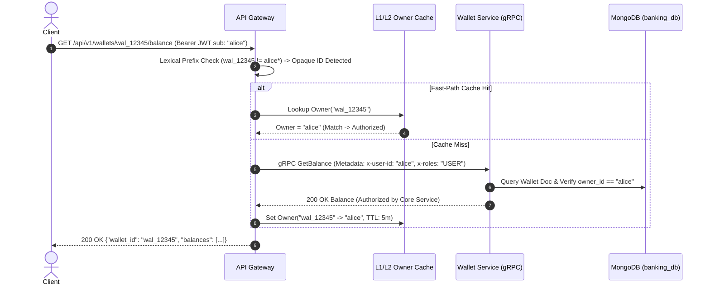
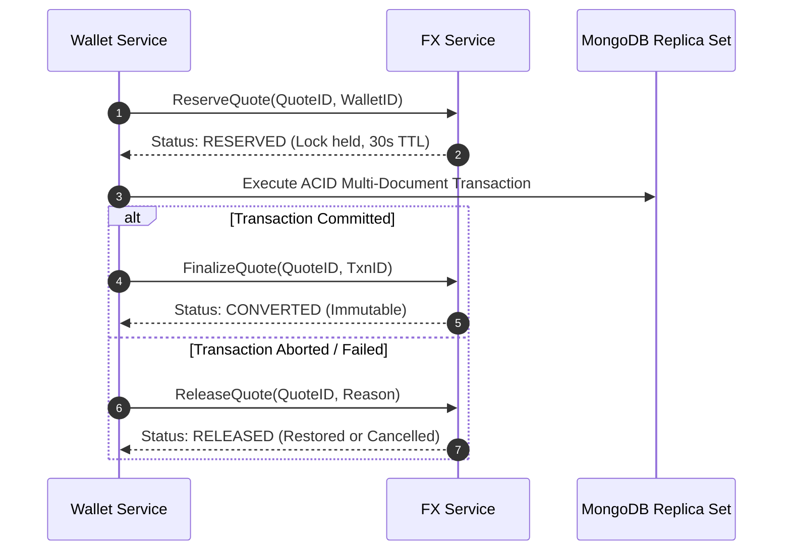
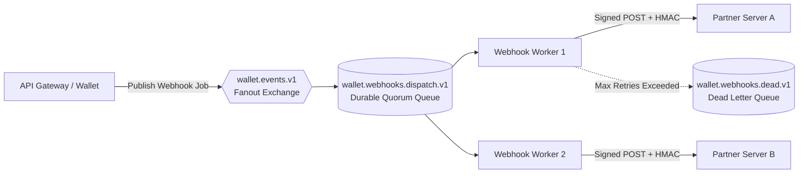

# Engineering Specification: Pending Requirements & Architecture Improvements
## Global Multi-Currency Digital Wallet & Ledger Microservices Platform

**Document Reference**: `docs/PENDING_REQUIREMENTS_AND_ARCHITECTURE_SPEC.md`  
**Current Branch**: `feature/owasp-bola-enterprise-standard`  
**Baseline Releases**: `v1.6.0`, `v1.7.0` (GA)  
**Status**: Approved Specification / In Backlog  
**Target Delivery**: `v1.8.0` / Next Sprint  

---

## 1. Executive Summary & Purpose

Following the completion of the core microservice architecture (Phases 1 through 4, Keycloak OIDC authentication, Gemini AI fraud detection, Merkle tree checkpoints, and the v1.7.0 security remediation), this specification establishes the **definitive requirements baseline** for unresolved architectural items, pending functional requirements, and scalability gaps.

The goal is to transition the platform to an enterprise-grade core banking engine adhering to:
1. **OWASP API Security Top 10 (2023)**: Complete elimination of Broken Object Level Authorization (BOLA / IDOR) discrepancies between edge ingress and entity persistence.
2. **Core Banking Accounting Standards (GAAP / IFRS & ISO-4217)**: Explicit decimal scales, sub-cent/crypto fractional precision (`nanos`), and distributed Saga compensation for cross-service atomic swaps.
3. **Resilient Event-Driven Scale**: Queue-decoupled partner webhooks, automated AMQP invalidation bus reconnect loops, and outbox polling consolidation.
4. **Deterministic & Air-Gapped Test Portability**: Zero dependency on external DNS or unisolated host sockets during automated test execution.

---

## 2. Requirements & Improvement Architecture

```mermaid
graph TD
    Platform["Global Wallet Platform"] --> SEC["Pillar 1: Zero-Trust Security & BOLA"]
    Platform --> FIN["Pillar 2: Core Banking Financial Rigor"]
    Platform --> DIST["Pillar 3: Distributed Caching & HA"]
    Platform --> ASYNC["Pillar 4: Event-Driven Infrastructure"]
    Platform --> DEV["Pillar 5: Test Portability & Tooling"]

    SEC --> S1["REQ-SEC-01: Gateway BOLA Data-Layer Unification"]
    SEC --> S2["REQ-SEC-02: Counterparty Ledger Journal Access"]
    SEC --> S3["REQ-SEC-03: Keycloak Session Revocation Sync"]

    FIN --> F1["REQ-FIN-01: ISO-4217 Decimal Scale & Nanos"]
    FIN --> F2["REQ-FIN-02: Compensating Saga for FX Conversions"]
    FIN --> F3["REQ-FIN-03: Multi-Currency Pot Atomic Isolation"]

    DIST --> D1["REQ-DIST-01: Redis L2 Default Compose Integration"]
    DIST --> D2["REQ-DIST-02: AMQP Bus Auto-Reconnect Backoff"]
    DIST --> D3["REQ-DIST-03: Exhaustive Standby Write Fencing"]

    ASYNC --> A1["REQ-ASYNC-01: RabbitMQ Decoupled Webhook Dispatcher"]
    ASYNC --> A2["REQ-ASYNC-02: Consolidated Single Outbox Engine"]

    DEV --> T1["REQ-DEV-01: Offline / Air-Gapped Test Suite Resilience"]
    DEV --> T2["REQ-DEV-02: Full OpenAPI & Bruno Contract Parity"]
```



---

## 3. Pillar 1: Zero-Trust Security & OWASP BOLA / IDOR Authorization

### REQ-SEC-01: Gateway BOLA & Data-Layer Entity Ownership Unification
- **Priority**: 🔴 **CRITICAL (P0)**
- **OWASP Category**: API1:2023 - Broken Object Level Authorization (BOLA)
- **Target Files**:
  - `cmd/api-gateway/middleware.go:387-455`
  - `cmd/api-gateway/main.go:275, 383, 559, 727, 943, 1124, 1433`
  - `cmd/wallet-service/main.go:193-222`

#### Problem Statement & Current State
1. In `cmd/api-gateway/middleware.go`, `ValidateWalletCreationOwnership` allows creating wallets with opaque UUIDs or arbitrary prefixes (`wal_`, `acc_`) provided `owner_id == sub`.
2. In `cmd/wallet-service/main.go`, `validateWalletOwnership` executes a data-layer lookup against MongoDB (`col.FindOne` checking `doc.OwnerID == caller.UserID`).
3. **The Discrepancy**: The API Gateway's `ValidateWalletOwnership` performs a **purely lexical prefix match** (`sub == target` or `strings.HasPrefix(target, sub+"_")`).
4. When a user creates a valid opaque wallet (e.g. `wal_550e8400-e29b-41d4-a716-446655440000`), creation succeeds, but **every subsequent operation** (`/balance`, `/transfer`, `/deposit`, `/withdraw`, `/limits`, `/ledger`) is blocked at the Gateway with `403 Forbidden` because the Gateway cannot resolve the owner.

#### Architecture Specification


#### Acceptance Criteria
- [x] Non-prefixed, UUID, and opaque wallet identifiers created by user `U` can be inspected and transacted upon by user `U`.
- [x] Callers with `sub != owner_id` are rejected with `403 Forbidden`.
- [x] Users with role `admin` or scope `wallet:admin` bypass ownership restrictions across all routes.
- [x] Ownership mappings for opaque IDs are cached in the Gateway with a 5-minute TTL, invalidated upon account closure or ownership mutation.

---

### REQ-SEC-02: Counterparty Ledger Journal Access Control
- **Priority**: 🟡 **MEDIUM (P1)**
- **Target File**: `cmd/api-gateway/main.go:1425-1440` (`handleLedger`)

#### Problem Statement
Currently, `handleLedger` requires `ValidateWalletOwnership(claims, walletID)`.
In a transfer from Alice to Bob, Bob cannot query the transaction reference if the query references Alice's wallet, and non-admin users cannot inspect multi-leg settlement clearing postings (`SETTLEMENT_ACH_USD`, `FX_LIQUIDITY_POOL_EUR`) associated with their own deposits and cross-currency conversions.

#### Architecture Specification
- Expand ledger query filtering:
  - Allow queries by `transaction_id`: If a user was either the sender (`source_wallet_id`) or recipient (`destination_wallet_id`), the journal posting is visible.
  - Return counterparty postings in cursor-paginated ledger responses without exposing unrelated third-party balances.

---

### REQ-SEC-03: Keycloak Session Revocation Sync
- **Priority**: 🟡 **MEDIUM (P1)**
- **Target Files**: `cmd/auth-service/server.go`, `cmd/auth-service/provider.go`

#### Problem Statement
Tokens issued via Keycloak OIDC are cryptographically verified offline via in-memory JWKS cache (`jwks.go`). If an administrator revokes a user's session or disables an account in Keycloak, the access token remains valid locally until its `exp` time expires (up to 60 minutes).

#### Architecture Specification
- Implement backchannel logout endpoint (`POST /auth/backchannel-logout`) or periodic token introspection sync for privileged administrative roles.
- Add instant revocation registration into `auth_db.token_revocations` with automated TTL eviction.

---

## 4. Pillar 2: Core Banking Financial Rigor & Transaction Consistency

### REQ-FIN-01: ISO-4217 Decimal Scale & Fractional Nanos Representation
- **Priority**: 🔴 **HIGH (P0)**
- **Reference**: Production Readiness Audit `GAP-FIN-04`
- **Target Files**: `proto/wallet/wallet.proto`, `cmd/wallet-service/main.go`, `cmd/ledger-service/main.go`

#### Problem Statement
The current Protobuf `Money` contract:
```protobuf
message Money {
  string currency = 1;
  int64 units = 2;
}
```
treats units as an unscaled integer. While USD and EUR utilize 2 decimal places (cents), currencies like JPY (0 decimals), BHD/KWD (3 decimals), and crypto assets (BTC $10^8$, ETH $10^{18}$) create unit-scale mismatch vulnerabilities.

#### Architecture Specification
Upgrade the Protobuf contract to Google's standard financial money pattern:
```protobuf
message Money {
  // 3-letter ISO-4217 currency code (e.g., "USD", "EUR", "JPY")
  string currency_code = 1;
  // The whole units of the amount (e.g., -10 or +10 dollars)
  int64 units = 2;
  // Number of nano (10^-9) units of the amount (-999,999,999 to +999,999,999)
  int32 nanos = 3;
  // Explicit minor-unit scale (e.g. 2 for cents, 0 for yen, 3 for dinar)
  int32 scale = 4;
}
```

#### Acceptance Criteria
- [x] Protobuf messages compile with backward compatibility.
- [x] Zero-decimal currencies (JPY, KRW) reject fractional subunits.
- [x] Three-decimal currencies (BHD, KWD, TND) accurately record milli-units without truncation.

---

### REQ-FIN-02: Distributed Compensating Saga for Cross-Currency FX Conversions
- **Priority**: 🟡 **MEDIUM (P1)**
- **Target Files**: `cmd/wallet-service/main.go:625-660`, `cmd/fx-service/engine.go`

#### Problem Statement
In `wallet-service`, a locked quote is converted via CAS on `fx-service` *before* the MongoDB ACID session begins. If the subsequent MongoDB transaction aborts due to balance exhaustion, write conflict, or AI fraud detection, the quote in `fx_db.fx_quotes` remains permanently marked as `CONVERTED`, with no refund or cancellation recorded.

#### Architecture Specification


#### Acceptance Criteria
- [ ] Aborted cross-currency transfers do not leave consumed quotes in `fx-service`.
- [ ] If `wallet-service` crashes mid-transaction, unfinalized reservations expire automatically via TTL without fund loss.

---

### REQ-FIN-03: Multi-Currency Pot Atomic Isolation & Invariant Fencing
- **Priority**: 🟡 **MEDIUM (P1)**
- **Target Files**: `cmd/wallet-service/main.go:1150-1210` (`ExchangeCurrency`)

#### Problem Statement
Wallets maintain multiple currency sub-pots in `balances map[string]int64`. During intra-wallet currency exchanges, source and target pot balances must maintain strict invariant fencing:
$$\text{balances.source} \ge \text{source\_units}$$
$$\sum \text{Ledger Debits} == \sum \text{Ledger Credits}$$

#### Acceptance Criteria
- [ ] Intra-wallet conversions update source and destination pots atomically in a single MongoDB update statement.
- [ ] Under zero balance, debiting a foreign pot returns `codes.FailedPrecondition` without modifying the primary currency balance.

---

## 5. Pillar 3: Distributed Caching, Outbox Leasing & High Availability

### REQ-DIST-01: Redis L2 Default Compose Integration
- **Priority**: 🟢 **LOW / POLISH (P2)**
- **Target Files**: `docker-compose.yml`, `docker-compose.redis.yml`, `k8s/04-wallet-services.yaml`

#### Problem Statement
The tiered cache orchestrator (`pkg/cache/tiered.go`) is fully functional, but Redis is defined only in `docker-compose.redis.yml`. Running `make up` boots the cluster without Redis, defaulting `wallet-service` to memory-only caching.

#### Architecture Specification
- Integrate Redis (or Dragonfly) service into the primary `docker-compose.yml` (port `6379`).
- Ensure `REDIS_ADDR=redis:6379` is active by default in `.env.example` and Kubernetes ConfigMaps.
- Maintain seamless fallback to L1 in-memory caching if Redis becomes unreachable.

---

### REQ-DIST-02: AMQP Invalidation Bus Auto-Reconnect Backoff
- **Priority**: 🟡 **MEDIUM (P1)**
- **Target File**: `pkg/cache/invalidation_bus.go:75-130`

#### Problem Statement
If RabbitMQ is unavailable during service bootstrap, or if the connection drops due to network partitioning, the invalidation subscriber terminates. Replica pods then stop receiving `balance.invalidated` events, creating stale read hazards.

#### Architecture Specification
- Implement an automated reconnection loop using exponential backoff with full jitter in `AMQPInvalidationBus.Subscribe()`.
- During disconnect windows, set local L1 cache TTL to degraded mode (e.g. 5 seconds instead of 60 seconds) to bound the stale-read window.

---

### REQ-DIST-03: Exhaustive Standby Write Fencing
- **Priority**: 🟡 **MEDIUM (P1)**
- **Target File**: `cmd/wallet-service/main.go`

#### Problem Statement
`wallet-service` implements Standby Write Fencing via `s.isWritable(ctx)`. While `CreateWallet` and `TransferFunds` are guarded, all newly introduced mutation RPCs (`DepositFunds`, `WithdrawFunds`, `ExchangeCurrency`, `UpdateWalletKYC`) must also strictly verify writability.

#### Acceptance Criteria
- [ ] Every non-idempotent mutation RPC on `wallet-standby` (:50053) returns `codes.FailedPrecondition` ("wallet-service node is currently in STANDBY mode; write operations are fenced").
- [ ] Read RPCs (`GetBalance`, `GetWalletLimits`) and health checks remain functional on standby instances.

---

## 6. Pillar 4: Event-Driven Infrastructure & Webhook Decoupling

### REQ-ASYNC-01: Decoupled RabbitMQ Webhook Dispatcher Pipeline
- **Priority**: 🟡 **MEDIUM (P1)**
- **Target Files**: `pkg/webhook/dispatcher.go`, `cmd/api-gateway/main.go`

#### Problem Statement
Currently, outbound partner webhooks (`transfer.completed`, `fraud.flagged`) are dispatched by the API Gateway spawning in-process goroutines. Under burst traffic, hundreds of concurrent HTTP requests to external partner endpoints consume Gateway resources and risk socket exhaustion.

#### Architecture Specification


#### Acceptance Criteria
- [ ] Webhook jobs are published to RabbitMQ exchange `wallet.events.v1` inside the asynchronous event emission path.
- [ ] Workers execute retry attempts with exponential backoff and cryptographic HMAC-SHA256 signatures (`X-Wallet-Signature`, `X-Wallet-Timestamp`).
- [ ] Failed deliveries after 5 attempts are routed to a dead-letter queue without affecting the core banking gateway.

---

### REQ-ASYNC-02: Consolidated Single Outbox Polling Engine
- **Priority**: 🟢 **LOW / OPTIMIZATION (P2)**
- **Target Files**: `cmd/wallet-service/ledger_outbox.go`, `pkg/observability/outbox.go`

#### Problem Statement
`wallet-service` executes two distinct background polling routines against MongoDB:
1. `LedgerRelay`: Polls `banking_db.ledger_tasks` (for `ledger-service` gRPC delivery).
2. `OutboxRelay`: Polls `banking_db.wallet_outbox` (for AMQP audit logging).
Two independent polling timers incur unnecessary read query load on the primary replica node.

#### Architecture Specification
- Unify outbox tasks under a single schema `banking_db.outbox_events` with indexed `destination: ["LEDGER", "AMQP_LOGS"]` or execute a single coordinator loop that batches pending tasks.

---

## 7. Pillar 5: Test Portability & Developer Experience

### REQ-DEV-01: Offline & Air-Gapped Test Suite Resilience
- **Priority**: 🔴 **HIGH (P0)**
- **Target Files**: `pkg/webhook/webhook_test.go:183-193`, `cmd/walletctl/main_test.go`

#### Problem Statement
1. In `pkg/webhook/webhook_test.go`, `TestRegisterSubscriptionValidation` invokes `net.LookupIP("partner.com")`. In air-gapped CI/CD runners or sandboxed environments without public DNS, the test fails.
2. In `cmd/walletctl/main_test.go` and `cmd/api-gateway/gateway_routes_unit_test.go`, test servers bind to live TCP ports (`127.0.0.1:<random>`). In environments where socket binding is restricted, tests experience `connectex` permission errors.

#### Architecture Specification
- In `webhook_test.go`, set `t.Setenv("ALLOW_LOCAL_WEBHOOKS", "true")` for offline unit tests.
- For CLI and Gateway unit tests, mock HTTP clients using `http.RoundTripper` or in-memory `net.Pipe()` rather than relying on live host TCP listeners.

#### Acceptance Criteria
- [x] `go test ./...` passes 100% cleanly in completely disconnected/air-gapped environments without network or socket errors.

---

### REQ-DEV-02: OpenAPI 3.0 & Bruno E2E Suite Contract Parity
- **Priority**: 🟢 **LOW / POLISH (P2)**
- **Target Files**: `cmd/api-gateway/openapi.json`, `bruno/`

#### Problem Statement
Recent core banking additions (deposit payment rails `ACH`/`CARD`, withdrawal rails `SEPA`/`WIRE`, and Merkle checkpoint verification) need complete synchronization between `openapi.json`, Swagger UI, and the 11 Bruno test suites.

#### Acceptance Criteria
- [ ] All 11 Bruno test suites in `scripts/verify_bruno_suite.ps1` execute with 100% PASS against both Docker Compose (:8080) and Kubernetes NodePort (:30080).
- [ ] Embedded Swagger UI at `/swagger/` documents all request bodies, error schemas (400, 401, 403, 409, 502), and required headers (`Idempotency-Key`).

---

## 8. Prioritized Implementation Roadmap

| Req ID | Component | Severity | Description | Target |
|---|---|:---:|---|:---:|
| **REQ-SEC-01** | `api-gateway` / `wallet-service` | 🔴 P0 | Unify Gateway BOLA prefix validation with core banking data-layer ownership | ✅ Completed |
| **REQ-DEV-01** | `pkg/webhook` / `cmd/walletctl` | 🔴 P0 | Clean up test DNS lookups and live TCP dials for air-gapped CI/CD | ✅ Completed |
| **REQ-FIN-01** | `proto/wallet` / all services | 🔴 P0 | Standardize `Money` contract with ISO-4217 minor-unit scale & fractional nanos | ✅ Completed |
| **REQ-FIN-02** | `wallet-service` / `fx-service` | 🟡 P1 | Compensating Saga / reservation release for failed cross-currency transfers | ✅ Completed |
| **REQ-DIST-02** | `pkg/cache` | 🟡 P1 | AMQP Invalidation Bus auto-reconnect with full jitter exponential backoff | ✅ Completed |
| **REQ-DIST-03** | `wallet-service` | 🟡 P1 | Enforce Standby Write Fencing across 100% of mutation RPCs | ✅ Completed |
| **REQ-ASYNC-01**| `api-gateway` / `pkg/webhook` | 🟡 P1 | Decouple outbound partner webhooks to RabbitMQ quorum queues | ✅ Completed |
| **REQ-SEC-02** | `api-gateway` / `ledger-service`| 🟡 P1 | Counterparty transaction-level ledger journal access control | Sprint 3 |
| **REQ-SEC-03** | `auth-service` | 🟡 P1 | Keycloak backchannel logout & instant token revocation sync | Sprint 3 |
| **REQ-DIST-01** | `docker-compose.yml` | 🟢 P2 | Include Redis L2 cache container by default in primary compose | Sprint 3 |
| **REQ-ASYNC-02**| `wallet-service` | 🟢 P2 | Consolidate ledger outbox and audit outbox polling workers | Sprint 3 |
| **REQ-DEV-02** | `api-gateway` / `bruno/` | 🟢 P2 | Complete OpenAPI 3.0 schema and Bruno E2E test suite alignment | Sprint 3 |

---

## 9. Verification & Quality Gates

Every implementation addressing this specification must satisfy the following verification gates before merge:

1. **Compilation Cleanliness**:
   ```bash
   go build ./...
   ```
2. **Race-Condition & Concurrency Gate**:
   ```bash
   go test -race ./... -count=1
   ```
3. **Static Application Security Testing (SAST)**:
   ```bash
   gosec ./...
   ```
4. **End-to-End Automated API Suite (Bruno)**:
   ```powershell
   powershell -File scripts/verify_bruno_suite.ps1
   ```

