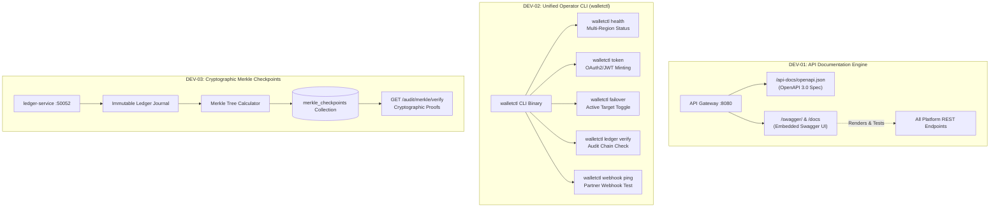

# Pillar 5: Developer Experience, Tooling & Auditing Guide

## 1. Executive Overview

**Pillar 5** focuses on operational excellence, developer ergonomics, and external regulatory auditability for the Global Wallet Microservices Platform. With the core banking expansion (Pillar 4) complete, Pillar 5 introduces:

1. **DEV-01: OpenAPI 3.0 & Embedded Swagger UI**: An interactive, self-contained API documentation portal embedded directly into `api-gateway`, enabling developers and partner integrators to explore, test, and integrate with zero external dependencies.
2. **DEV-02: Unified CLI Utility (`walletctl`)**: A modern Go command-line tool providing SREs, operators, and developers with diagnostic, token minting, failover orchestration, and audit capabilities.
3. **DEV-03: Merkle Root Ledger Checkpoints**: Cryptographic batch Merkle tree generation over immutable ledger transaction chains to produce verifiable mathematical proofs for regulatory attestation.

---

## 2. Pillar 5 Workstream Architecture

---

## 3. Workstream Deep Dive

### 3.1. DEV-01: OpenAPI 3.0 & Embedded Swagger UI

#### Objectives & Design Principles
- **Specification Standard**: Strict OpenAPI 3.0.3 compliance with rich schemas, descriptive summaries, error responses (400, 401, 403, 404, 409, 429, 500, 502, 503), and zero-trust security schemes (`BearerAuth`).
- **Zero-Dependency Self-Contained Embedding**:
  - Uses Go 1.16+ `//go:embed` to package the OpenAPI JSON specification and Swagger UI distribution assets directly into the `api-gateway` binary.
  - Functions completely offline in air-gapped environments, local Docker Compose setups, and air-gapped Kubernetes clusters.
- **Route Surface Exposed**:
  - `GET /api-docs/openapi.json`: Machine-readable raw OpenAPI JSON spec for CI validation, code generation, and client SDK builders.
  - `GET /swagger/` & `GET /docs`: Human-readable interactive UI with "Try it out" capabilities.
- **Coverage Catalog**:
  - Authentication & Token Endpoints (`/api/v1/auth/token`, `/api/v1/auth/refresh`, `/api/v1/auth/logout`)
  - Wallet Lifecycle & Pots (`/api/v1/wallets`, `/api/v1/wallets/{id}/balance`)
  - Intra-System Transfers & FX (`/api/v1/wallets/transfer`, `/api/v1/wallets/exchange`)
  - Compliance & Velocity Limits (`/api/v1/wallets/kyc`, `/api/v1/wallets/limits`)
  - Inbound & Outbound Rails (`/api/v1/wallets/deposit`, `/api/v1/wallets/withdraw`)
  - Outbound Partner Webhooks (`/api/v1/webhooks/subscriptions`, `/api/v1/webhooks/test`)
  - Cluster Operational Endpoints (`/api/v1/cluster/status`, `/api/v1/cluster/failover`, `/healthz`, `/readyz`)

---

### 3.2. DEV-02: Unified CLI Utility (`walletctl`)

#### Objectives & Command Architecture
`walletctl` provides operators and developers with an idiomatic command-line tool built with Go:
- **`walletctl health`**: Connects to the API Gateway, Primary Wallet, Standby Wallet, FX Engine, and Ledger Service to report connection latencies, replica set health, and active routed targets.
- **`walletctl token`**: Generates pre-signed JWT tokens using local HMAC secrets or remote Keycloak endpoints with configurable roles (`USER`, `ADMIN`) and scopes (`wallet:read`, `wallet:write`, `wallet:transfer`, `cluster:admin`).
- **`walletctl failover`**: Inspects and changes the active gateway routing target (`PRIMARY` vs `STANDBY`) with safety confirmation prompts.
- **`walletctl ledger verify`**: Performs end-to-end cryptographic SHA-256 hash chain verification for a given wallet ID or across the entire ledger.
- **`walletctl webhook ping`**: Sends test payloads to verify partner webhook receiver endpoints and measure response latencies.

---

### 3.3. DEV-03: Merkle Root Ledger Checkpoints

#### Objectives & Cryptographic Proofs
While `ledger-service` maintains sequential SHA-256 hash chaining linking each entry to its predecessor, proving that a specific transaction exists in a historical ledger of millions of entries requires traversing $O(N)$ records.
- **Binary Merkle Tree**: Computes a balanced Merkle tree over batches of transactions (e.g. every 1,000 journal entries or hourly epoch).
- **$O(\log N)$ Audit Proofs**: Generates cryptographic inclusion proofs (Merkle audit path) allowing auditors to verify transaction inclusion without downloading the complete ledger database.
- **Immutable Checkpoints**: Stores `{ epoch_id, start_seq, end_seq, merkle_root, entry_count, timestamp }` in MongoDB and emits external cryptographic checkpoints.

---

## 4. Execution Roadmap & Milestones

| Task ID | Component | Focus | Target Release |
|---|---|---|:---:|
| **DEV-01** | `api-gateway` | OpenAPI 3.0 Specification & Embedded Swagger UI | `v1.6.0-rc.1` |
| **DEV-02** | `cmd/walletctl` | Unified CLI Utility for SREs & Developers | `v1.6.0-rc.2` |
| **DEV-03** | `ledger-service` & `pkg/merkle` | Merkle Root Checkpoints & Verification Proofs | `v1.6.0-rc.3` |
| **REL-05** | `main` | Production Merge & Release v1.6.0 | `v1.6.0` |
