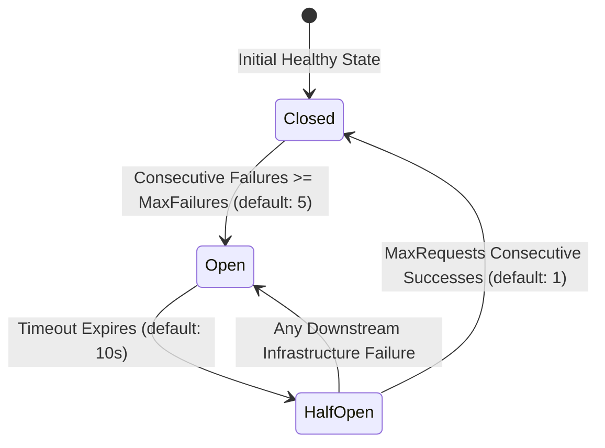
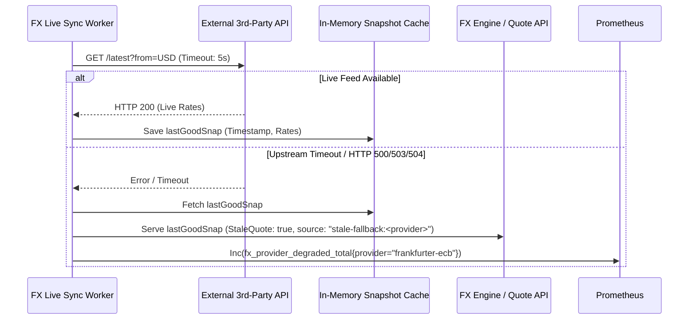

# Resilience, Circuit Breaking & Graceful Fallback Guide

This guide details the architectural implementation of **Pillar 3: Resilience, Circuit Breaking & Graceful Fallback (Hardening)** across the Global Multi-Currency Digital Wallet microservices ecosystem.

---

## 1. Overview & Objectives

In a distributed core-banking microservice topology, network partitions, downstream latency spikes, and provider outages are inevitable. Without active fault isolation, intermittent failures cascade across synchronous network boundaries, depleting thread pools, exhausting connections, and causing systemic outages.

Pillar 3 introduces three hardening defenses:
1. **Client-Side Circuit Breaking with Business-Error Passthrough**: Wraps all inter-service gRPC dials in configurable circuit breakers (`github.com/sony/gobreaker/v2`), failing fast when downstream services become unavailable without blocking callers.
2. **Resilient Foreign Exchange (FX) Stale Fallback**: Caches last-known-good rate snapshots and serves them with `stale_quote: true` and Prometheus alerts when external rate providers (Frankfurter/ECB) fail or timeout.
3. **Outbox Relay Exponential Backoff with Full Randomized Jitter**: Replaces static outbox polling with dynamic, full-jitter exponential backoff bounded by configurable limits to prevent thundering herds on recovery, implemented using cryptographically secure random numbers (`crypto/rand`, OWASP CWE-338 compliant).

---

## 2. Client-Side Circuit Breaking (`pkg/resilience`)

### 2.1 State Transition Lifecycle

The circuit breaker operates as a finite state machine managing downstream health:



- **Closed**: Requests pass through normally. Downstream failures are counted.
- **Open**: Downstream service is deemed unhealthy. Outgoing RPCs fail immediately with `codes.Unavailable` ("circuit breaker is open"), avoiding wasted network I/O and latency.
- **Half-Open**: After the timeout elapses, a controlled number of trial requests (`MaxRequests: 1`) are allowed through. If successful, the circuit closes; if they fail, the circuit returns to `Open`.

### 2.2 Intelligent Error Classification (`IsSuccessful`)

A critical requirement in banking APIs is distinguishing between **business/validation errors** and **infrastructure failures**:

| gRPC Status Code | Classification | Circuit Breaker Action | Rationale |
|---|---|---|---|
| `codes.OK` | Success | Records Success | Call succeeded normally |
| `codes.InvalidArgument` | Business Error | **Treated as Success** | Client submitted invalid JSON or negative amounts; downstream service is healthy |
| `codes.NotFound` | Business Error | **Treated as Success** | Wallet or entity not found; service is functioning correctly |
| `codes.AlreadyExists` | Business Error | **Treated as Success** | Duplicate idempotency key or wallet ID |
| `codes.Unauthenticated` | Business Error | **Treated as Success** | Invalid JWT or bad signature |
| `codes.PermissionDenied` | Business Error | **Treated as Success** | IDOR or RBAC authorization rejection |
| `codes.FailedPrecondition`| Business Error | **Treated as Success** | Insufficient balance or currency mismatch |
| `codes.Unavailable` | Infrastructure Failure | **Records Failure** | Downstream pod down, connection refused, or network timeout |
| `codes.DeadlineExceeded` | Infrastructure Failure | **Records Failure** | Downstream pod timed out |
| `codes.Internal` | Infrastructure Failure | **Records Failure** | Downstream unhandled panic or database crash |
| `codes.ResourceExhausted`| Infrastructure Failure | **Records Failure** | Downstream rate-limiting or memory exhaustion |

### 2.3 Protected Microservice Boundaries

```
[ Client / Web ]
       │
       ▼
[ API Gateway ]
  ├── (CB: 'gateway-to-auth')   ──> [ Auth Service (:50054) ]
  ├── (CB: 'gateway-to-wallet') ──> [ Wallet Primary (:50051) / Standby (:50053) ]
  ├── (CB: 'gateway-to-ledger') ──> [ Ledger Service (:50052) ]
  └── (CB: 'gateway-to-fx')     ──> [ FX Engine Service (:50055) ]

[ Wallet Service (Primary/Standby) ]
  ├── (CB: 'wallet-to-ledger')  ──> [ Ledger Service (:50052) ]
  └── (CB: 'wallet-to-fx')      ──> [ FX Engine Service (:50055) ]
```

---

## 3. Resilient FX Stale Fallback Engine (`cmd/fx-service`)

### 3.1 Snapshot Caching & Degraded Fallback

Foreign Exchange operations depend on live external rate feeds (Frankfurter, European Central Bank, Open Exchange Rates). When internet connectivity drops or upstream APIs return HTTP 503/504, the FX Engine automatically activates graceful degradation:



### 3.2 Observability & Alerting

- **Prometheus Metric**: `fx_provider_degraded_total{provider="...", source="..."}` counter increments on every fallback event.
- **Quote Flagging**: The generated quote explicitly carries:
  ```json
  {
    "quote_id": "fxq_9876543210ab",
    "source_currency": "USD",
    "target_currency": "EUR",
    "exchange_rate": "0.920000",
    "stale_quote": true,
    "provider": "stale-fallback:frankfurter-ecb"
  }
  ```
- **Logging**: Emits structured warning:
  `[FX-PROVIDER] Warning: All live 3rd-party rate providers failed (...); returning last-known good rates (stale_quote: true)`

---

## 4. Outbox Relay Full-Jitter Exponential Backoff (`cmd/wallet-service`)

### 4.1 Thundering Herd Prevention

When the Ledger Service restarts or experiences heavy load, a static outbox polling loop (e.g. fixed 1-second interval) floods the recovering service with simultaneous retry spikes from all wallet workers.

Pillar 3 implements **Full Randomized Jitter Exponential Backoff**:

$$\text{Cap} = \min(\text{maxBackoff},\, \text{pollInterval} \times 2^{\text{consecutiveErrors}-1})$$

$$\text{NextInterval} = \text{pollInterval} + \text{rand}(0,\, \text{Cap} - \text{pollInterval})$$

- **Base Interval (`pollInterval`)**: Default `1s` (configurable via `LEDGER_RELAY_POLL_INTERVAL`).
- **Maximum Backoff (`maxBackoff`)**: Default `30s` (configurable via `WithMaxBackoff`).
- **Recovery**: As soon as a batch dispatches successfully, `consecutiveFailures` resets to `0` and the timer immediately returns to `pollInterval`.

### 4.2 OWASP CWE-338 & GoSec Security Compliance

Standard `math/rand` pseudo-random generators use predictable seeds that trigger security warnings (CWE-338: Use of Cryptographically Weak Pseudo-Random Number Generator).

The outbox backoff engine utilizes Go's standard `crypto/rand` with `math/big`:
```go
// Use cryptographically secure random number generator (CWE-338 compliant)
maxBig := big.NewInt(int64(jitterRange))
n, err := rand.Int(rand.Reader, maxBig)
if err != nil {
    return r.pollInterval
}
return r.pollInterval + time.Duration(n.Int64())
```
This guarantees zero static analysis findings under **GoSec**, **SonarQube**, and **Fortify SAST**.

---

## 5. Verification & Testing

Run the full resilience and race detection test suite:

```bash
# Verify circuit breaker state transitions and business error classification
go test -v -race ./pkg/resilience/...

# Verify FX stale fallback and quote degradation
go test -v -race -run TestCompositeRateProvider_StaleFallback ./cmd/fx-service/...

# Verify outbox backoff bounds and recovery
go test -v -race -run TestLedgerRelay_CalculateBackoff ./cmd/wallet-service/...

# Verify zero security findings
go run github.com/securego/gosec/v2/cmd/gosec@latest -exclude-generated -severity medium ./cmd/... ./pkg/...
```
