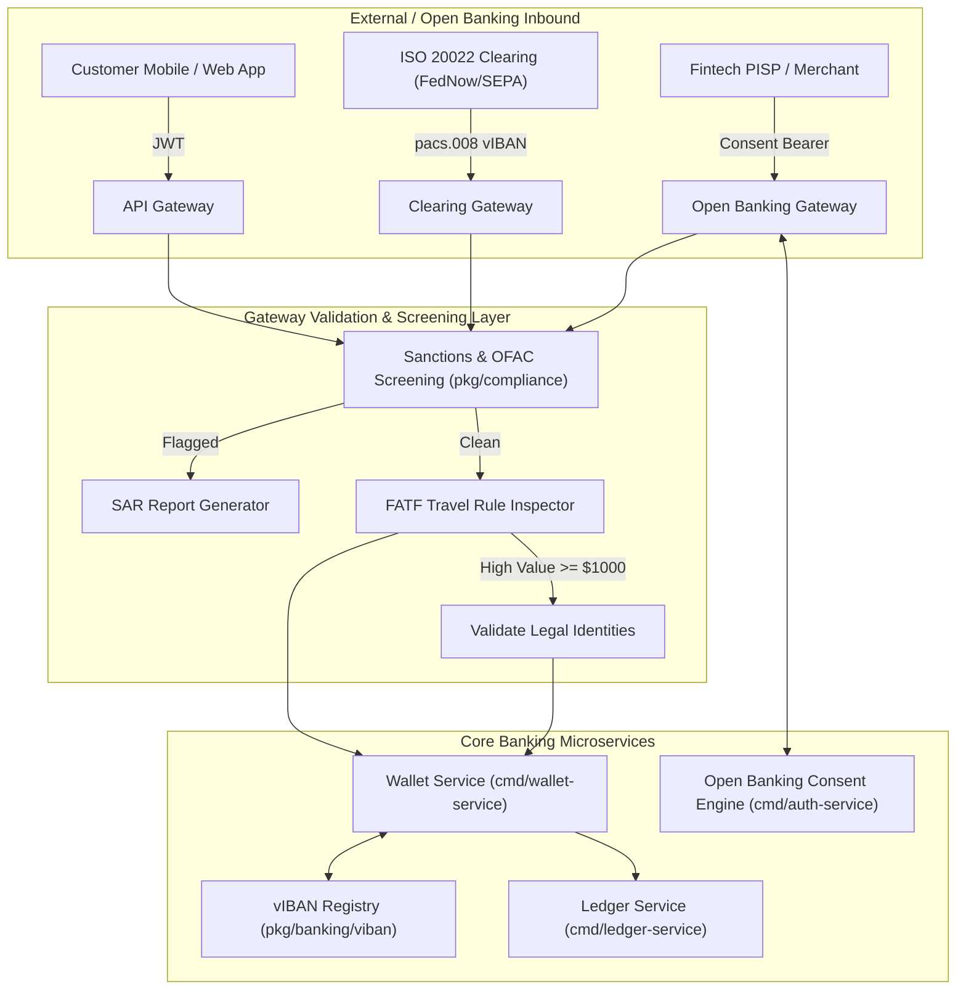

# Sprint 5 Specification: Compliance, BaaS Virtual IBANs & Open Banking PSD2

**Document Reference**: `docs/SPRINT_5_SPECIFICATION_AND_DELIVERABLES.md`  
**Target Version**: `v1.12.0`  
**Status**: Ready for Implementation  
**Standard References**: FATF Recommendation 16 (Travel Rule), OFAC SDN / FinCEN SAR, ISO 13616 (vIBANs), PSD2 / UK Open Banking Read/Write Standard v3.1  

---

## 1. Executive Summary

Following the delivery of **Sprint 4 (`v1.11.0`)** (ISO 20022 Clearing Rails & GAAP/IFRS Multi-Tier Chart of Accounts), **Sprint 5** establishes institutional regulatory compliance, multi-tenant Banking-as-a-Service (BaaS) infrastructure, and standardized Open Banking interfaces:
1. **`REQ-COMP-01` (P0)**: **FATF Recommendation 16 (Travel Rule) Engine** — Enforces mandatory originator and beneficiary legal entity identification on cross-border transactions $\ge \$1,000$.
2. **`REQ-COMP-02` (P0)**: **Real-Time Sanctions Screening & SAR Generator** — Sub-millisecond OFAC SDN and global sanctions list matching with automated FinCEN Suspicious Activity Report (SAR) XML/JSON generation.
3. **`REQ-BAAS-01` (P1)**: **Virtual IBAN (vIBAN) Management Engine** — Dynamic issuance of ISO 13616 compliant virtual IBANs linked to wallet currency pots with seamless inbound clearing routing.
4. **`REQ-OPEN-01` (P1)**: **Open Banking (PSD2 / UK Open Banking) Consent Framework** — Standardized consent lifecycle and dedicated AISP/PISP APIs (`/open-banking/accounts`, `/open-banking/balances`, `/open-banking/payments`).
5. **`REQ-TEST-05` (P2)**: **Automated E2E Testing & OpenAPI Parity** — Automated Bruno requests and OpenAPI 3.1 schema definitions.

---

## 2. Technical Architecture & Component Flow

---

## 3. Detailed Deliverables & Implementation Plan

### 3.1. REQ-COMP-01 & REQ-COMP-02: Compliance & Sanctions (`pkg/compliance`)
- **`pkg/compliance/travel_rule.go`**:
  - `TravelRuleParty`: Name, Address, AccountNumber, NationalID, Country, BIC.
  - `ValidateTravelRule(amount float64, currency string, orig, benef TravelRuleParty) error`.
- **`pkg/compliance/sanctions.go`**:
  - `SanctionsEngine`: Pre-loaded indexed SDN sanctions database with normalized token matching and phonetic fuzzy searching.
  - `ScreenParty(name, country string) (*SanctionsMatchResult, error)`.
  - `GenerateSAR(reportID, reason string, parties []TravelRuleParty, txns []SARTransaction) ([]byte, error)`.

### 3.2. REQ-BAAS-01: Virtual IBAN (vIBAN) Management (`pkg/banking` & `cmd/wallet-service`)
- **`pkg/banking/viban.go`**:
  - `VirtualIBANRegistry`: In-memory and persistent MongoDB collection `virtual_ibans`.
  - Assigns unique, check-digit verified vIBANs (`GB`, `DE`, `FR`) mapped to specific `wallet_id` and `currency`.
  - Resolution hook: `ResolveVirtualIBAN(iban string) (*VirtualIBANMapping, error)`.
- **Endpoints in `cmd/api-gateway`**:
  - `POST /api/v1/wallets/:id/vibans`
  - `GET /api/v1/wallets/:id/vibans`
  - `DELETE /api/v1/wallets/:id/vibans/:iban`

### 3.3. REQ-OPEN-01: Open Banking PSD2 Framework
- **`pkg/openbanking/consent.go`**:
  - Consent status: `AWAITING_AUTHORISATION`, `AUTHORISED`, `REJECTED`, `REVOKED`, `EXPIRED`.
  - Granular scopes: `ReadAccountsDetail`, `ReadBalances`, `ReadTransactionsDetail`, `CreatePaymentInitiation`.
- **Endpoints in `cmd/api-gateway`**:
  - `POST /api/v1/open-banking/consents`
  - `GET /api/v1/open-banking/consents/:id`
  - `DELETE /api/v1/open-banking/consents/:id`
  - `GET /api/v1/open-banking/accounts`
  - `GET /api/v1/open-banking/accounts/:id/balances`
  - `POST /api/v1/open-banking/payments`
