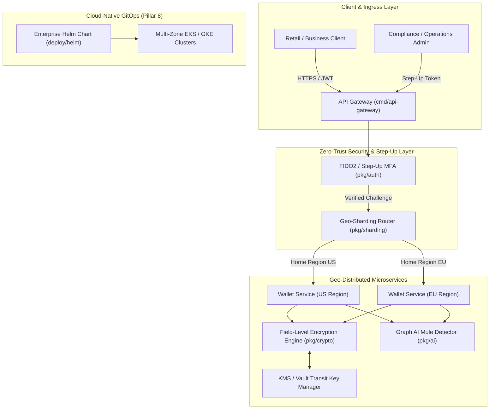

# Sprint 6 Specification: Zero-Trust Security, KMS/Vault FLE, FIDO2 Step-Up MFA, Active-Active Scale & Production Helm

**Document Reference**: `docs/SPRINT_6_SPECIFICATION_AND_DELIVERABLES.md`  
**Target Version**: `v1.13.0`  
**Status**: In Progress  
**Standard References**: PCI-DSS v4.0, NIST SP 800-57 (Key Management), FIDO2 / WebAuthn, CNCF Cloud Native (Helm v3), FATF Complex Topology Analysis  

---

## 1. Executive Summary

Following the delivery of **Sprint 4 (`v1.11.0`)** and **Sprint 5 (`v1.12.0`)**, which established institutional clearing rails (ISO 20022), GAAP/IFRS accounting, FATF Travel Rule, OFAC sanctions screening, and Open Banking PSD2, **Sprint 6 (`v1.13.0`)** focuses on institutional zero-trust security, field-level database encryption, active-active multi-region scale, production Helm infrastructure, and AI graph intelligence:

1. **`REQ-SEC-04` (P0)**: **Field-Level Encryption (FLE) & KMS Envelope Encryption Engine** — High-performance AES-256-GCM envelope encryption protecting customer PII (tax IDs, national IDs, physical addresses, bank account numbers) at rest per PCI-DSS v4.0 and NIST SP 800-57, with automated key versioning (`v1`, `v2`).
2. **`REQ-SEC-05` (P1)**: **FIDO2 / WebAuthn Step-Up MFA Challenge Framework** — Ephemeral challenge-response framework requiring hardware passkey / biometric verification for privileged mutations (high-value transfers $\ge \$10,000$, KYC tier updates, cluster failover).
3. **`REQ-SCALE-01` (P1)**: **Active-Active Geo-Sharding & Deterministic Home-Region Routing** — Enables multi-region active writes without standby fencing bottlenecks. Directs requests to deterministic home regions with sub-10ms commit latency and cross-region distributed Sagas.
4. **`REQ-OPS-01` (P1)**: **Production-Ready Enterprise Helm Chart Suite** — Parameterized cloud-native deployment suite (`deploy/helm/global-wallet/`) with environment configurations (`dev`, `staging`, `production`), HPAs, PDBs, and Prometheus metrics scraping.
5. **`REQ-AI-02` (P2)**: **Graph AI Money Mule & Smurfing Network Detector** — Real-time transaction graph topology engine detecting circular wash cycles, rapid passthrough hops, and fan-out/fan-in smurfing networks within rolling 72-hour windows.
6. **`REQ-TEST-06` (P2)**: **Zero-Trust & Scale Automated Test Suite** — Comprehensive Bruno test collections (`bruno/13-Security-ZeroTrust/`, `bruno/14-Geo-Sharding/`), PowerShell test harness updates, and OpenAPI 3.1 specification parity.

---

## 2. Technical Architecture & Component Flow

---

## 3. Detailed Deliverables & Implementation Plan

### 3.1. REQ-SEC-04: Field-Level Encryption Engine (`pkg/crypto`)
- **`pkg/crypto/fle.go`**:
  - `KeyManager`: Interface for wrapping/unwrapping Data Encryption Keys (DEKs) using Key Encryption Keys (KEKs).
  - `LocalKMSKeyManager`: In-memory and environment-backed master key manager with versioned keys (`v1`, `v2`).
  - `EnvelopeCipher`: AES-256-GCM cipher generating per-field ephemeral DEKs and 12-byte cryptographic nonces.
  - Formats: `kms:<version>:<base64-iv>:<base64-ciphertext>:<base64-tag>`.
  - Transparent field masking helper for audit logging and PII redaction.
- **Verification**: `pkg/crypto/fle_test.go` with 100% unit test coverage.

### 3.2. REQ-SEC-05: FIDO2 / WebAuthn Step-Up MFA (`pkg/auth` & `cmd/api-gateway`)
- **`pkg/auth/stepup.go`**:
  - Challenge store generating cryptographically secure 32-byte nonces with a strict 5-minute TTL.
  - Verifies signed challenge responses or TOTP backup codes.
  - Issues elevated contextual tokens / claims with `stepup:elevated` scope.
- **Endpoints in `cmd/api-gateway`**:
  - `POST /api/v1/auth/step-up/challenge` — Issues an ephemeral cryptographic challenge.
  - `POST /api/v1/auth/step-up/verify` — Validates the proof and grants elevated permissions.
  - Integrated into high-value transfers ($\ge \$10,000$), admin failover, and KYC tier updates.
- **Verification**: `pkg/auth/stepup_test.go` and `cmd/api-gateway/main_test.go`.

### 3.3. REQ-SCALE-01: Active-Active Geo-Sharding & Deterministic Home-Region Routing (`pkg/sharding`)
- **`pkg/sharding/router.go`**:
  - Home-region assignment based on account residency or consistent Murmur3 hashing across regional clusters (`us-east-1`, `eu-west-1`, `ap-southeast-1`).
  - Request router directing mutation traffic to the wallet's home region with sub-10ms local commit latency.
  - Distributed 2-phase cross-region transfer coordination for multi-regional settlement.
- **Verification**: `pkg/sharding/sharding_test.go`.

### 3.4. REQ-OPS-01: Production-Ready Enterprise Helm Chart Suite (`deploy/helm/global-wallet`)
- **Directory**: `deploy/helm/global-wallet/`
  - `Chart.yaml` — Chart metadata and semantic versioning.
  - `values.yaml` — Default development parameters.
  - `values-staging.yaml` — Staging cluster configuration.
  - `values-production.yaml` — High availability, multi-zone replica configuration with resource quotas.
  - `templates/`:
    - `_helpers.tpl`
    - `configmap-secrets.yaml`
    - `api-gateway-deployment.yaml`, `api-gateway-service.yaml`
    - `wallet-service-deployment.yaml`, `wallet-service-service.yaml`
    - `ledger-service-deployment.yaml`, `ledger-service-service.yaml`
    - `auth-service-deployment.yaml`, `auth-service-service.yaml`
    - `fx-service-deployment.yaml`, `fx-service-service.yaml`
    - `logging-service-deployment.yaml`, `logging-service-service.yaml`
    - `ingress.yaml`
    - `hpa.yaml` — Horizontal Pod Autoscaling (CPU / Memory $\ge 75\%$).
    - `pdb.yaml` — Pod Disruption Budgets (`minAvailable: 1`).
    - `service-monitors.yaml` — Prometheus metrics scraping endpoints.

### 3.5. REQ-AI-02: Graph AI Mule Ring & Smurfing Network Detector (`pkg/ai`)
- **`pkg/ai/graph.go`**:
  - `MuleGraphEngine`: Maintains in-memory directed transaction graph over rolling 72-hour sliding windows.
  - Detects:
    1. **Circular Layering Loops**: $A \to B \to C \to A$ (wash trading / obfuscation).
    2. **Rapid Passthrough Velocity**: Account receiving and forwarding funds within $< 180\text{ seconds}$ with $< 5\%$ retention.
    3. **Fan-Out / Fan-In Smurfing**: One source dispersing funds to 5+ intermediary wallets that converge into a single exit wallet within 4 hours.
  - Flags high-risk transactions with `MuleRiskScore` and triggers automated webhook alerting.
- **Verification**: `pkg/ai/graph_test.go`.

### 3.6. REQ-TEST-06: Automated Test Suite & OpenAPI Parity
- **Bruno Collection**:
  - `bruno/13-Security-ZeroTrust/01-Request-StepUp-Challenge.bru`
  - `bruno/13-Security-ZeroTrust/02-Verify-StepUp-Challenge.bru`
  - `bruno/13-Security-ZeroTrust/03-Protected-Mutation-Without-StepUp.bru`
  - `bruno/14-Geo-Sharding/01-Get-Home-Region.bru`
- **OpenAPI 3.1 Specification**: Updated `cmd/api-gateway/openapi.json`.
- **Test Harness**: Updated `scripts/verify_bruno_suite.ps1`.

---

## 4. Pre-Push Verification Protocol

All commits on Sprint 6 must strictly pass the 6-step verification gate before pushing to remote:
1. `gofmt -l .` (using Go 1.26.11)
2. `staticcheck ./pkg/... ./cmd/...`
3. `go vet ./cmd/... ./pkg/...`
4. `gosec -exclude-generated -severity medium ./cmd/... ./pkg/...`
5. `go test -race ./cmd/... ./pkg/...`
6. `go build ./cmd/...`
