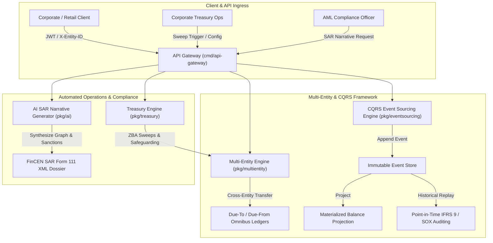

# Sprint 7 Specification: Multi-Entity Banking, CQRS Event Sourcing, Automated Treasury Sweeps & AI SAR Filing

**Document Reference**: `docs/SPRINT_7_SPECIFICATION_AND_DELIVERABLES.md`  
**Target Version**: `v1.14.0`  
**Status**: In Progress  
**Standard References**: IFRS 9 / SOX 404 (Point-in-Time Auditing), FinCEN Form 111 (Suspicious Activity Report), FCA / BaFin / MAS Safeguarding Regulations, Basel III Liquidity Standards  

---

## 1. Executive Summary

Building upon the zero-trust security and active-active scale established in **Sprint 6 (`v1.13.0`)**, **Sprint 7 (`v1.14.0`)** delivers enterprise institutional banking capabilities required for multinational financial institutions, regulated fintechs, and correspondent banking networks:

1. **`REQ-CORE-01` (P0)**: **Multi-Entity Tenant Partitioning & Inter-Entity Omnibus Settlement** (`pkg/multientity`) — Strict logical and financial segregation across legal banking entities (`US_ENTITY_CORP`, `EU_ENTITY_GMBH`, `GB_ENTITY_LTD`, `SG_ENTITY_PTE`), automated inter-entity Due-To / Due-From ledger accounts, and atomic cross-entity settlement journals.
2. **`REQ-EVENT-01` (P0)**: **Distributed CQRS Event Sourcing & Point-in-Time Ledger Auditing** (`pkg/eventsourcing`) — Immutable append-only event stream (`AccountOpened`, `FundsCredited`, `FundsDebited`, `FundsHeld`, `FundsReleased`) with high-performance materialized read projections in Redis/memory. Enables nanosecond historical balance reconstruction as of any timestamp $T$ per IFRS 9 and SOX 404 requirements.
3. **`REQ-TREAS-01` (P1)**: **Automated Treasury Liquidity Sweeping & Target Balancing** (`pkg/treasury`) — Configurable automated Zero-Balance Account (ZBA) sweeps, target operating balance maintenance, and automated customer safeguarding reserve calculations/replenishments (100% backing of customer deposits with central bank/trust reserves).
4. **`REQ-AI-03` (P1)**: **Generative AI Automated SAR Narratives & Sanctions Dossier Engine** (`pkg/ai/sar.go`) — Transforms graph mule topologies, rapid passthrough alerts, and OFAC screening matches into standardized, regulator-ready FinCEN Suspicious Activity Report (SAR) XML/narratives with automated risk scoring and evidentiary audit trails.
5. **`REQ-TEST-07` (P2)**: **Enterprise Multi-Entity & Event Sourcing Test Suite** — Comprehensive Bruno test collections (`bruno/15-Multi-Entity-Treasury/`, `bruno/16-CQRS-Event-Sourcing/`), automated test harness runner updates ([`scripts/verify_bruno_suite.ps1`](../scripts/verify_bruno_suite.ps1)), and OpenAPI 3.1 specification parity ([`cmd/api-gateway/openapi.json`](../cmd/api-gateway/openapi.json)).

---

## 2. Technical Architecture & Component Flow

---

## 3. Detailed Deliverables & Implementation Plan

### 3.1. REQ-CORE-01: Multi-Entity Partitioning & Inter-Entity Settlement (`pkg/multientity`)
- `LegalEntity`: Defines corporate entities (`US_CORP`, `EU_GMBH`, `GB_LTD`, `SG_PTE`), jurisdictions, base currencies, and regulatory regimes.
- `EntityRegistry`: Thread-safe registry mapping accounts and wallets to legal entities.
- `InterEntitySettler`: Coordinates transfers between wallets belonging to different legal entities. Generates balanced double-entry omnibus postings:
  - Debit Source Customer Account (in Source Entity)
  - Credit Inter-Entity Due-To Entity Account (in Source Entity)
  - Debit Inter-Entity Due-From Entity Account (in Target Entity)
  - Credit Target Customer Account (in Target Entity)
- Verification: `pkg/multientity/multientity_test.go` with 100% test coverage.

### 3.2. REQ-EVENT-01: Distributed CQRS Event Sourcing & Point-in-Time Auditing (`pkg/eventsourcing`)
- `Event`: Structured immutable records (`AccountOpened`, `FundsCredited`, `FundsDebited`, `FundsHeld`, `FundsReleased`).
- `EventStore`: Thread-safe append-only event store with sequential versioning per account.
- `Projector`: Materialized view maintaining current available, held, and posted balances.
- `ReconstructBalanceAt(accountID string, timestamp time.Time)`: Replays event streams up to the requested microsecond/nanosecond cutoff to generate verifiable balance snapshots for financial audits.
- Verification: `pkg/eventsourcing/eventsourcing_test.go` with 100% test coverage.

### 3.3. REQ-TREAS-01: Automated Treasury Sweeping & Target Balancing (`pkg/treasury`)
- `SweepRule`: Configuration for Zero-Balance Accounts (ZBA), minimum working capital targets, and maximum excess balance caps.
- `TreasuryEngine`: Executes automated sweeps transferring excess cash from operational accounts to master liquidity pool accounts.
- `SafeguardingReserveCalculator`: Validates that 100% of customer deposits are safeguarded in qualified trustee accounts, identifying surplus/deficit and generating automated rebalancing actions.
- Verification: `pkg/treasury/treasury_test.go` with 100% test coverage.

### 3.4. REQ-AI-03: AI Automated SAR Narratives & Sanctions Dossier Engine (`pkg/ai`)
- `SARNarrativeGenerator`: Ingests graph mule alerts (circular wash trading, rapid passthroughs, smurfing rings) and OFAC screening matches.
- Generates compliant, natural language narrative dossiers matching FinCEN Form 111 Part V (Suspicious Activity Information Narrative).
- Verification: `pkg/ai/sar_test.go` with 100% test coverage.

### 3.5. REQ-TEST-07: Automated Test Suite & OpenAPI 3.1 Contract Parity
- Bruno collections:
  - `bruno/15-Multi-Entity-Treasury/`
  - `bruno/16-CQRS-Event-Sourcing/`
- Integration in `cmd/api-gateway/main.go` and `cmd/api-gateway/sprint7_test.go`.
- Updated `cmd/api-gateway/openapi.json` to version `1.14.0`.
- Updated `scripts/verify_bruno_suite.ps1`.
